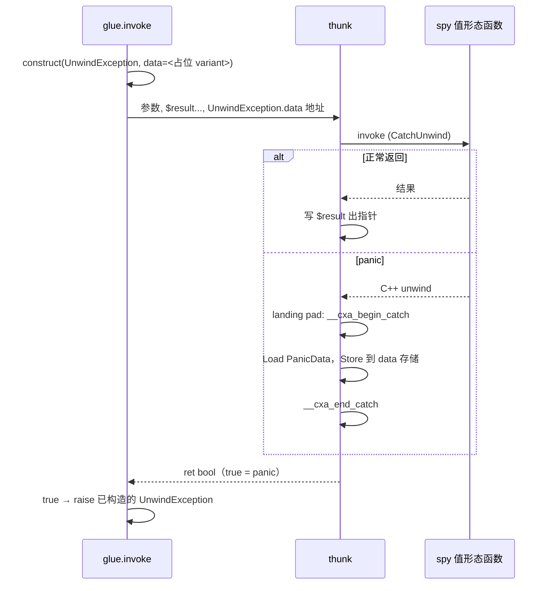

# Python 边界捕获 panic 的方案

## 目标

spy 函数 panic 时，不再让 C++ 异常穿出 thunk 进入 ctypes/Python 栈导致进程退出，而是：

1. thunk 捕获 panic；
2. 把 `PanicData` 交回 Python；
3. Python 把它作为 `std.core.UnwindException` 重新抛出。

## 现状与根因

`fn._make_thunk` 目前用 `mir.Call` 调用值形态函数。panic 由 `__cxa_throw` 抛出后，thunk 没有 personality / landing pad，异常直接穿出 JIT 栈帧，进入 ctypes/Python 调用栈；找不到 handler 时触发 `std::terminate`，整个 Python 进程退出。

## 总体流程



## 1. MIR：新增 `mir.EndCatch`

`mir.py` 新增一条语义化指令（MIR 保持 ABI 中立）：

```python
@dataclass(eq=False, slots=True)
class EndCatch(Inst):
    """The caught exception a ``CatchUnwind`` landing pad began handling has
    been copied out; release it.  ABI-neutral: ``lower`` maps it to the
    target ABI's end-catch (``__cxa_end_catch`` on Itanium)."""

    def get_children(self) -> tuple[Any, ...]:
        return ()

    def map_values(self, f: Callable[[Value], Value]) -> Self:
        return self
```

`lower._lower_inst` 增加：

```python
case mir.EndCatch():
    block.call(sllvm.CXA_END_CATCH)
```

`CXA_END_CATCH` 已经在 `llvm.py` 中声明（`__cxa_end_catch`），本次只是开始使用。

`EndCatch` 必须在把 payload 拷出之后、离开 catch 块之前发射。`__cxa_end_catch` 会销毁并释放 `__cxa_allocate_exception` 分配的异常对象，拷贝必须发生在它之前。

## 2. thunk（`fn._make_thunk`）

### 新 ABI

在原有参数（声明参数 + 每个存储结果叶的 `$result` 出指针）之后，追加一个隐藏参数：

- `$unwind: Ptr[PanicData]`：Python 提供的目标存储地址，即 `UnwindException.data` 字段的地址。

thunk 的返回类型由 `void` 改为 `bool`：

- `false`：正常返回；
- `true`：捕获到 panic。

### 调用改为 `mir.CatchUnwind`

```python
caught_slot = mir.Alloca(mir.PointerType(panic_data_type))
thunk.entry.emit(caught_slot)
unwind = mir.Param(unwind_index, mir.PointerType(panic_data_type))

normal = mir.BasicBlock()
catch = mir.BasicBlock()

# catch：把捕获到的 PanicData 值写入 $unwind，然后释放 C++ 异常对象
pointer = mir.Load(caught_slot)      # Ptr[PanicData]
catch.emit(pointer)
value = mir.Load(pointer)            # PanicData
catch.emit(value)
catch.emit(mir.Store(unwind, value))
catch.emit(mir.EndCatch())
catch.emit(mir.Ret(mir.BoolValue(True)))

call = mir.CatchUnwind(
    fn, tuple(call_args), fn.ret_type, normal, catch, caught_slot,
)
thunk.entry.emit(call)
```

- `normal` 块：沿用原有的结果交付逻辑（by-value 结果叶 `Store` 到自己的 `$result`），最后 `Ret(BoolValue(False))`；
- `NoReturn` 的被调函数：`CatchUnwind` 的 type 用 `mir.NORETURN`，`normal` 块仍存在并 `Ret(BoolValue(False))`（不可达），`catch` 块照常 `Ret(BoolValue(True))`；
- 拷贝是 MIR 的 typed `Load`/`Store`，宽度由 `PanicData` 的 MIR 类型与 `lower` 的 `DataLayout`（由 `TargetInfo` 决定）给出，不传 size，不使用 `ctypes.sizeof`，也不新增 `Memcpy`。

### `PanicData` 的 MIR 类型

`_make_thunk` 不 import / resolve `std.core.PanicData`，只接收一个 `mir.Type`：

```python
def _make_thunk(
    fn: mir.Function,
    ret_spec: RetSpec,
    cache: MirLowerCache,
    panic_data_type: mir.Type,
) -> mir.Function:
    ...
```

该类型用于 `$unwind` 的 pointee、`caught_slot` 的元素类型以及 catch 块的 `Load`/`Store`。

## 3. `PanicData` MIR 类型的传递

`CompileBatch` 不保存该类型。`CompileBatch.compile` 在 `newly_compiled` 非空时 lazy import / resolve 一次，并直接传给 `_make_thunk`：

```python
def compile(
    self, symbol_table: SymbolTable, backend: Backend,
    resolver: sval.CompileContext,
):
    target = resolver.target_info()
    cache = self.mir_lower_cache

    panic_data_type: mir.Type | None = None
    if self.newly_compiled:
        from ..std.core import PanicData
        panic_type = sval.as_value(PanicData, resolver)
        assert isinstance(panic_type, sval.Type)
        panic_data_type = panic_type.to_mir_type(cache)
        assert panic_data_type is not None

    for instance in self.newly_compiled:
        ...
        _make_thunk(instance.mir, ret_spec, cache, panic_data_type)
```

- `compile` 的 target 由 `resolver.target_info()` 给出；调用点（`dsl._RegisteredFn.__call__` / `_Context._resolve_call`）传 `self.context` / `self`；
- 必须使用目标 context 解析：`StructType` 的 MIR mirror 缓存在该 context 的 spy `StructType` 上，`UnwindException.data` 的布局也来自它；
- 没有 `newly_compiled` 时不解析、也不 import；
- `Analyser.finish()` 不再做任何计算；`_make_thunk` 只看到 `mir.Type`。

## 4. `glue.invoke`

### 占位构造 `UnwindException`

在调用前先构造一个 `UnwindException`，目的只是获得 `data` 字段的存储；具体初始化成哪个 variant 不重要，因为 panic 时 thunk 会用 typed `Store` 整个覆盖 `PanicData`（tag + payload）。

```python
from ..std.core import UnwindException

unwind_type = sval.as_value(UnwindException, context)
assert isinstance(unwind_type, StructType)

unwind = construct(
    unwind_type.head, unwind_type.generic_args,
    (0,), {}, context, exception=True,
)

data_index = unwind_type.field_index('data')
assert data_index is not None
data_offset = _field_offset(unwind_type, data_index, cache)
py_args.append(ctypes.c_void_p(unwind._data._base() + data_offset))
```

- `glue` 只 lazy import / resolve `UnwindException`，不 resolve `PanicData`；
- `construct` 负责分配 `UnwindException` 的存储并写占位值；字段偏移通过 `_field_offset` 获取，单字段 mirror 等 layout 规则统一由 `StructType` / `_field_offset` 处理；
- 占位值 `0` 会按整数 variant 推断，写入的 tag 随后被 thunk 覆盖。

### 调用与重新抛出

```python
if native.call(*py_args):
    raise cast(_ExceptionInstance, unwind)
return _read_result(instance, buffers, context)
```

- 正常返回时，占位对象被丢弃；
- panic 时，`unwind` 的 `data` 已被 thunk 覆盖，直接作为 Python 异常抛出。

### `construct` 的 `exception` 参数

`construct` 增加 keyword-only 参数：

```python
def construct(
    head, generic_args, args, kwargs, context, *,
    exception: bool = False,
) -> _StructInstance:
    ...
    if exception:
        return _ExceptionInstance(type, buffer, 0, context)
    return _StructInstance(type, buffer, 0, context)
```

其余构造逻辑不变。

## 5. `std.core.catch_unwind`

`interp._build_catch_path` 目前已经把捕获到的 `PanicData` 拷贝进 `UnwindException.data`，在拷贝完成后、dispatch 之前补一条：

```python
self._emit(mir.EndCatch())
```

这样 `catch_unwind` 与 Python 边界使用同一套“拷出 payload 再 end-catch”的释放逻辑，C++ 异常对象不再泄漏。

## 6. 文档与测试

- `doc/en|zh/implementation.md`
  - §5.3 thunk：追加 `$unwind` 参数、bool 返回值、`CatchUnwind` 与 typed copy；
  - §7.2 指令列表：加入 `EndCatch`；
  - §9.2 异常展开：catch 块在拷出 payload 后调用 end-catch；
  - §10 Python 边界：占位构造 `UnwindException`、`data` 字段地址、panic 时重新抛出。
- `doc/en|zh/features.md` §5.8：未捕获的 panic 在 Python 调用边界被捕获，并作为 `UnwindException` 抛出，不再终止进程。
- `spy/tests/panic.py`
  - Python 直接调用 `panic_i32(41)`，断言抛出异常且 `e.data == 41`；
  - IR 断言：thunk 与 `catch_unwind` 的 IR 中出现 `__cxa_end_catch`。
