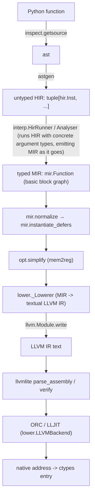

# spy compiler implementation

This document describes how the stages of **the current code** (`spy/spy/compiler/`) cooperate to compile Python source into native machine code.
Observable behavior is in `doc/features.md`; the derivation of the behavior spec is in `doc/archive/comptime-refactor/behaviour.md` (archived).

---

## 0. Pipeline overview

Two layers of "type" run throughout:

- **spy types** (`sval.Type`): the only type domain the compile-time interpreter trusts; decides layout strategy, ABI, and specialization keys.
- **MIR types** (`mir.Type`): produced only at actual emit/lower time by `sval.Type.to_mir_type(cache)`.
  The interpreter **never reads back** MIR types to make decisions (open-loop).

---

## 1. Module map

| File | Responsibility |
|---|---|
| `compiler/__init__.py` | Public interface: `func`/`struct`/`func_type`/`decl_func`/`typeof` and the various type constants |
| `compiler/syntax.py` | Syntax markers inside function bodies: pointer types, `ref`, `Array`/`array`, `Option`, `Comptime`/`ConstComptime`/`InferComptime`, `typeof`, `unroll`, `comptime()`, `defer` and `OK/RAISE/UNWIND/ERR/ALL`, `closure`, `Opaque`, C integer markers |
| `compiler/dsl.py` | Decorators and registration: `_Context` (per-host compile context), `_RegisteredFn`/`_RegisteredClass`/`_FuncTypeDecl`/`_DeclFuncDecl`, the various Metadata, `IntEnum` support |
| `compiler/astgen.py` | Python `ast` -> HIR; signature parsing (`parse_function`), scopes, closures, RLS, marker recognition |
| `compiler/hir.py` | HIR instruction set and result location types (`ResultLocTree`/`FullResultLoc`/`ReturnLoc`) |
| `compiler/sval.py` | spy type system, compile-time values, `Box`/`ComptimePtr`, layout cache `MirLowerCache`, return spec, `as_value`/`coerce_const`, `TypeVarSolver` |
| `compiler/interp.py` | Compile-time interpreter (`HirRunner`) and compile driver (`Analyser`): runs HIR -> emits MIR |
| `compiler/fn.py` | Signature model (`Signature`/`CallSignature`/`ReturnSignature`), `ArgNode`, `FunctionValue`/`FunctionInstance`/`ClosureFunction`, thunk, `SymbolTable`, `CompileBatch` |
| `compiler/mir.py` | MIR types/values/instructions/basic blocks/terminators; `normalize`, `instantiate_defers` |
| `compiler/opt.py` | Single optimization: folds a single-access slot back into a register (conservative mem2reg) |
| `compiler/llvm.py` | Pure-textual LLVM IR builder (no libLLVM calls); `DataLayout`; JIT-agnostic |
| `compiler/lower.py` | MIR -> LLVM IR; `LLVMBackend` (the only place that uses llvmlite/JIT); exception unwind landing pads |
| `compiler/glue.py` | Python ↔ spy boundary: ctypes read/write, instance wrapping, `invoke`, result unwrapping |
| `compiler/target.py` | `TargetInfo` (pointer width, C integer widths, `usize` width) |
| `compiler/util.py` | Shared utilities (`IdentityObj`, `IndexedMap`, `StrBiMap`, `FrozenArraySet`, `TriState`, `frozendict`, etc.) |
| `compiler/errors.py` | `SpyError`/`CompileError` (with `loc` and a call chain)/`CoerceError`/`TypeMismatchError` |
| `compiler/source.py` | `SourceFile`/`SourceLoc`/`TraceFrame`; AST line mapping and diagnostic formatting (source snippet, caret, `called from`) |
| `compiler/binop.py` | Operator literal types (`UnaryOp`/`BinaryOp`/`CompareOp`/`BoolOp`) |

---

## 2. Frontend: `astgen` (Python `ast` -> HIR)

### 2.1 `parse_function`

`parse_function(fn, resolver, self_type=None, self_arg="ptr", context_type_vars=None, exceptions=None, callconv='default', may_panic=True) -> FunctionIR`:

1. `inspect.getsource` + `ast.parse`; requires exactly one `FunctionDef` with a matching name.
2. Rejects `posonlyargs`/`kwonlyargs`.
3. Reads PEP 695 `fn.__type_params__` -> `sval.TypeVar`; `context_type_vars` (the type parameters of the enclosing struct) is pre-set.
4. Reads `__annotations__`/`__defaults__` from the object; the return annotation is normalized (`-> None` -> `VoidType`, `-> Never` -> `EmptyType`, absent -> `None` meaning inferred).
5. Constructs an `fn.SignatureFormalArg` for each positional parameter: `Comptime`/`Comptime[T]` is split into `is_comptime`; `type[X]` -> `is_type_value`; the method receiver (`self_type`) is set by `self_arg` to `Ptr[Self]`/`ConstPtr[Self]`/by value.
6. `*args`/`**kwargs` (`vararg_formal`, rejecting `InferComptime`/`type[...]`); the exception set (`exception_set`).
7. Assembles `fn.Signature` + `FunctionIR(name, signature, arg_is_ref, ())`.
8. Creates a `_Builder`, declares the positional parameters as `hir.Arg(i)`, translates the function body, and appends `hir.StoreVoidRetloc()` at the end.

### 2.2 `_Builder`: scopes and declarations

- `_Scope` stack: each `vars: dict[str, hir.Value]` maps a name to a **pointer to that object** (slot / option / unwrap payload).
- `_declare`: binds only in the innermost block. `_lookup`: scans outward from the inside, and on a hit builds the capture chain through `_tunnel_through_closures`.
- `_lookup_within_function`: scans up to and including the innermost `_ClosureScope`, never crossing it — this decides whether an assignment **declares** a new variable.
- `_gen_body` **pre-declares the slots of a run of consecutive `def`s** (`Alloca`), so that self/mutual recursion can be resolved.
- Global resolution `_resolve_global`: `fn.__globals__` / builtin table; `range` -> `std.range`, `StopIteration` -> `std.StopIteration`,
  `bytes` -> `BytesType()`, `str` -> `StrType()`; `ord`/`len`/`isinstance`/`type` are kept as identity markers.
  `_resolve_closure`: first checks `co_freevars` (the value of a closure cell is embedded as a compile-time constant; if unbound and the name equals the function itself, returns the original `fn`, supporting self-reference at registration time).
- `_try_resolve_object`: folds a **global expression** down to its Python object (name or attribute); it is the backbone of all marker identity recognition.

### 2.3 Statement and expression translation

| Python | Lowering |
|---|---|
| `if`/`elif`/`else` | `hir.If(AsBool(cond))` … `Else` … `End`; when **the condition is an `and` chain**, uses `hir.Block` + `BreakIf` instead, so that names bound with `:=` in the condition dominate the body |
| `while` / `while-else` | Infinite loop `hir.Loop`; the block head re-evaluates the condition and, when false, runs `else` first and then `BreakLoop`; `is_inline` comes from `syntax.unroll()` |
| `for` | Explicit iterator loop: `it = iter.__iter__()` (commit) -> `Loop` -> `Try(StopIteration)` -> `target = it.__next__()` (commit) -> body -> `Except` -> `else` + `BreakLoop` |
| `try`/`except` | Clause type expressions are evaluated **before `Try`** (`hir.Try.except_types`); `binds` is the `as` name (a pre-built `ExceptBind`); `Try`/body/`Except(i)`/clause/`End`; try-else/finally, no except, and a bare `raise` are errors |
| `with syntax.defer(...)` | `hir.Defer(flags)` + body + `End`; flags are given by `defer()`/`okdefer()`/`errdefer()` or a compile-time integer expression |
| `match` | For tagged unions: `case _:` wildcard (must be last), `case T():` (`IsInstance`), `case T() as e:` (`TaggedUnionPayloadPtr`); guards/subpatterns are not supported |
| `return` | With a value: `_gen_result_loc(value, ReturnLoc())`; without: `StoreVoidRetloc()`; then `hir.Ret()` |
| `raise` | New slot + `_gen_result_loc(exc, slot)` + `hir.Raise(slot)` |
| `assign` | `_gen_lhs` (declares `Alloca` if the name is unbound) + `_gen_result_loc(value, result_loc)` + `CommitSlot`; **handles only `targets[0]`** |
| `annassign` | `_split_comptime` splits out `is_comptime`/`is_const`/the declared type; `ConstComptime` must carry an initial value; the name must not already be bound |
| `augassign` | lhs must be given by reference (`is_ref`, i.e. a pointer); emits `hir.BinaryAssign(op, lhs, rhs)` |
| `break`/`continue`/`pass` | `hir.BreakLoop` / `hir.Continue` / nothing |
| Expression statement | `_gen_expr` evaluates then discards (for side effects / forcing compile-time evaluation) |

Expression highlights:

- **Result location semantics (RLS)**: `_gen_result_loc(node, result_loc, allow_fall_back=True)` writes the result through the caller-provided **result location pointer** and produces no register.
  `hir.ReturnLoc()` denotes the entire function result location tree (a tree of pointers for a multiple-value result). The fallback of `_gen_expr` allocates a temporary `Alloca` for expressions that need a "value", writes via RLS, and returns that pointer.
- **Destructuring assignment**: `_gen_lhs` yields a **place tree** for a tuple target (`_gen_target_tuple`); when the RHS is a tuple expression and the target is a place tree, `_gen_result_loc` splits it **element by element** (`a, b = c, d` -> `a = c; b = d`, a length mismatch being an error in astgen),
  so the location of `hir.InitTuple`/`hir.TuplePtrElement` is **never** a tree (see §3; a tree can only come from a `ReturnLoc` the interpreter resolves).
- **Marker recognition** (by object identity): `_SYNTAX_CALLS = (ref, unroll, comptime, typeof)` -> `_gen_syntax_call`;
  statement-level markers (`unroll`/`comptime`/`const_comptime`/`infer_comptime`) are buffered as a pragma by `_as_marker` and consumed by the next statement (a dangling pragma is an error).
- Subscript dispatch for `a[...]`/`a[Literal[X]]`/`Ptr[T]`/`Array[T,N]`/`Option[T]`/`a[b:c]`/`a[i]` is in `astgen._gen_expr`, `_gen_type_ctor`, `_gen_literal`.
- `is None`/`is not None` (`_gen_is_none`), walrus `_gen_walrus`/`_gen_unwrap`, `isinstance` (`_gen_isinstance`).
- Call `_gen_call`: `cast` (no-op) -> `array` -> `isinstance` -> `ord` -> `len` -> if the attribute is an ordinary Python function, `CallInplace` (its callee resolves to a `sval.PyFunction`, evaluated by Python at compile time) ->
  if the attribute is a method, `CallMethodInplace` -> struct construction `FinishStruct` -> ordinary `CallInplace`.
  `_gen_arglist` currently **silently ignores `**kw` and errors on `*x`** (`hir.Spread` exists but astgen does not emit it, see `doc/issues.md` #1).

### 2.4 Closure capture (`_gen_closure`)

- Capture happens **lazily at lookup time** (`_tunnel_through_closures`): each `_ClosureScope` boundary crossed appends the current pointer into `captures` (deduplicated by name).
  The reader's own layer emits `hir.FieldIndexAddr(hir.Arg(0), index)`; intermediate layers emit a `_CaptureField(index)` marker, which `_gen_closure` finally materializes into a field access.
- `_gen_closure` evaluates the closure's annotations/defaults/return annotation in the **outer flow**, creates an `fn.ClosureFunction`, pushes a `_ClosureScope`,
  binds the parameters to `hir.Arg(i+1)` (`Arg(0)` is the closure's own anonymous struct), and finally emits `hir.MakeClosure(...)`.
- `_gen_function_def` stores the closure value into the slot of that name; `_gen_lambda` is a closure that is force-inlined, with a body of `RLS(body, ReturnLoc())` + `Ret()`.

### 2.5 Source locations and diagnostics

- `source.source_of_object(fn/cls)` reads the original source with `inspect.getsourcelines` (decorators included), parses it after `textwrap.dedent`, and then shifts every node with `ast.increment_lineno(tree, start - 1)` so line numbers are **absolute file lines**. `SourceFile` keeps the original lines, the dedent width and the first line; `SourceLoc` is 1-based with a half-open end range.
- `parse_function` hands the `SourceFile` to `_Builder`; `_Builder._gen_stmt`/`_gen_expr`/`_gen_result_loc` maintain the current node through `_at(node)`, and `add()` writes the current location into `hir.Inst.loc`. `CompileError.attach_loc` only fills an empty location, so the innermost node wins; intermediate layers such as `sval` need no location parameters.
- `interp._step` attaches the current instruction's `loc` to a `CompileError`; when the error crosses `_analyse_stack`, `Analyser._run` appends every `HirRunner`'s current instruction as a `called from` frame (innermost first), expanding a runner's inline `InlineFrame`s in the same order. An argument-conversion error prefers the argument value instruction's `loc`.
- `CompileError.__str__`/`format()` renders `path:line:col: error: ...`, a snippet whose caret covers the whole `SourceLoc`, and the `note: in function ...`/`note: called from ...` chain; `args[0]`/`message` stay the bare message.
- In IPython/Jupyter, `source.format_location` maps a cell's temporary filename to `In[N]` through `CachingCompiler.format_code_name()` (with `_filename_map` as a fallback); both the primary location and the `called from` frames use it. Plain scripts and imported modules keep their real path.
- `dsl._build_fn_type` and `_RegisteredClass.get_entry` take their locations from the declaration source: a parameter error points at the annotation node, a struct field error at the field annotation.

---

## 3. HIR (`hir.py`)

A linear untyped instruction stream; every `Inst` object is **its own result register** (identity equality) and carries the source location it was generated from (`Inst.loc`, see §2.5).

- `Value` base class; `Const(value)` (literal / immutable global value); `Arg(index)` (the **address** of the index-th parameter).
- `ReturnLoc` (**not** a `Value`); `type ResultLocTree = hir.Value | tuple[ResultLocTree, ...]`; `type FullResultLoc = ResultLocTree | ReturnLoc`.
- Instructions: `Alloca(is_comptime, is_const, type)`, `Load`, `Store(ptr, value)`, `StoreVoidRetloc`, `CommitSlot(slot)`;
  `FieldAddr`/`FieldIndexAddr` (`is_aggregate_init`), `FinishStruct`/`FinishArray`, `InitTuple`/`TuplePtrElement` (location is `Value | ReturnLoc`, never a tree, see §2.3), `Tuple`/`Dict`;
  `CallInplace`/`CallMethodInplace` (with `ret`), `CallArgs`/`Spread`;
  `Subscript`/`Slice`/`PtrCast`/`AsFuncPtr`/`TypeOfBegin`/`TypeOfEnd`;
  `Binary`/`BinaryAssign`/`Compare`/`Not`/`Unary`/`Ord`/`AsBool`/`Len`/`IsNull`/`OptionPayloadPtr`/`IsInstance`/`TaggedUnionPayloadPtr`;
  `If`/`Else`/`Loop`/`Block`/`BreakIf(cond, levels)`/`BreakLoop`/`Continue`/`End`;
  `Defer(flags)`/`Try(binds, except_types)`/`Except(index)`/`ExceptBind`/`Ret`/`Raise`/`MakeClosure`.
- `DeferPath(IntFlag)`: `OK=1`, `RAISE=2`, `UNWIND=4`, `ERR`, `ALL`.
- Block scanning: `scan_block` (returns the `Else`/`End` positions), `scan_try` (returns the positions of each `Except` and `End`) — because HIR is a flat stream with no nested structure.

---

## 4. Type and value system (`sval.py`)

### 4.1 One type, two roles

Every spy type is both an **annotation value** and a compile-time-usable **value**. Equality is mostly **structural** (frozen dataclass),
with a few **identity** ones (`IdentityObj`): `TypeVar`, `StructType`/`StructTypeHead`, `IntEnumType`, `Box`, `FunctionValue`.

### 4.2 `SpecialTypeKind` and `classify()`

`Type.classify()` is determined solely by the type itself (it does not look at MIR):

| kind | Meaning | Has MIR mirror | Has storage |
|---|---|---|---|
| `NONE` | Ordinary runtime type | Yes | Yes (unless ZST) |
| `COMPTIME` | Purely compile-time, no runtime representation | No | No |
| `ZST` | Zero-sized (unit) type | No | No |
| `DST` | Dynamically-sized: only a **pointer to it** is a value | No (only `fam_mir_type`) | No |

Derived: `is_zst()` = `classify()==ZST`; `is_copyable()` = `classify()!=DST` (containers override).
Key types: `IntType` (subtyped by range; an integer type is a subtype of a float type when its whole range lies within the float's exact integer range, see `float_exact_int_range`), `FloatType` (narrow -> wide subtyping), `BoolType`, `ComplexType`,
`PointerType`, `ArrayType`, `OptionType`, `TupleType`, `StrDictType`, `StructType`, `UnionType`, `TaggedUnionType`,
`ResultType`/`Success`, `FunctionType`/`AnyFunction`/`DeclareFunction`, `IntEnumType`,
`TypeType`/`AnyType`/`TypeVar`/`BytesType`/`StrType`/`EmptyType`/`VoidType`/`NullType`/`TypedNull`/`UndefinedType`/`ValueType`/`OpaqueType`.

### 4.3 Value domain and `Box`

- `AnyValue = Value | int | float | complex | bytes | str | bool`; `ScalarValue` is the subset that can occupy one `Box` cell
  (the aggregate forms `AggregateValue`/`TaggedUnionValue`/`UnionValue`/`OptionValue`/`TypedNull`/`UndefinedAggregate` are **not** among them; `is_scalar_value` decides).
- `Box(name_base, type, is_const, cells)`: identity object that **flattens** a value into a `list[ScalarValue]`; `reset(type)` initializes each cell to `UndefinedScalar` according to `scalar_leaves`.
- The box read/write helpers (all in `sval`; `interp` reads and writes `Box.cells` directly): `flatten_value` (including padding; `undefined` -> `UndefinedScalar` per leaf),
  `unflatten_cells` (its inverse), `fill_comptime_defaults` (fills `is_comptime` fields with defaults, iterative), `load_box_cells` (`bytes`/`str` box special case).

### 4.4 Struct layout (`StructType._calculate_mir`)

1. Collect the fields that have storage: skip `is_comptime`; `is_ref` -> `*const T` (skip ZST pointee); skip ZST;
   the first DST field becomes the FAM (later DSTs take no slot); the rest use `field.type.to_mir_type`.
2. `extern_c` keeps declaration order; a spy struct is **sorted by ascending alignment**.
3. Build `_field_mir_indices` (ZST field -> `None`, FAM -> `len(mirrored)`).
4. `_mir`: no mirrored field and no FAM -> `None` (zero-sized); exactly one mirrored field, not `extern_c`, no FAM -> **that field's own mirror**;
   otherwise -> `mir.StructType`.

`StructField(name, type, default, is_comptime, is_ref)`; `StructModifiers(extern_c, copyable)`;
`StructTypeHead.specialize(args)` memoizes each specialization (ensuring `typeof(x)==Foo` is meaningful).

### 4.5 Pointers and `ComptimePtr`

- `PointerType(elem, is_const, variant)`: convertible only when the elements are identical; `_points_at_elements_of` (`*[N]T` -> `T` multi-pointer);
  const can only be **added**; a peer's constness uses `_peer_const`. `to_mir_type`: ZST/Opaque pointee -> `void*`; unsized array pointee -> element pointer.
- `ComptimePtr(box: Box | bytes | str, offset: int, type: PointerType)`: structural eq/hash -> **is itself a specialization key** (same box + offset + view type).
- `pointer_object_type(ptr)`: the object the pointer names - its pointee; when it names an element of the array the `box` holds (at `offset`, same element type), the array's **tail** from that element on (the element's index is `offset // scalar_count(elem)`, the length `length - index`). Materializing that object is what keeps the elements after the first one (see §6.5).
  `is_writable()` requires the view to be non-const, the box to not be `bytes`/`str`, and `Box.is_const` to be false.
- `CastedPtr(ptr, type)`: the compile-time pointer after a `ptr_cast` reinterpretation; reads/writes cannot see through it.

### 4.6 Layout cache and special types (`MirLowerCache` / `SpecialTypes`)

`MirLowerCache` memoizes, per host/target, the mirrors that must be uniqued: `tuple_struct` (positional fields `_0,_1,…`), `strdict_struct` (fields = entry names),
`union_mir`, `option_struct_mir` (`{tag, value}`), `tagged_union_mir`, `complex_mir`.
`SpecialTypes` holds the types such as `std.core.slice`/`SlicePtr`/`ConstSlicePtr` that ought to be provided by `std` (one per host).

Struct helpers (mostly iterative): `alignment_of`, `aggregate_type_length`, `scalar_leaves` (flatten = the sequence of cells a value occupies),
`scalar_count`, `field_scalar_offset`, `find_first_pointer_type_pos` (the pointer position borrowed by an option), `tagged_union_shape`,
`_union_cell_width`.

### 4.7 Return spec and ABI

- `returns_via_result_ptr(type)`: not copyable -> True; a `TypeVar` mentioned in the aggregate -> False (assumed small); no mirror -> False; otherwise `estimated_size_of(mir) > 16`.
- `pass_by_ref(type) -> TriState`: mentions a type parameter -> `UNKNOWN`; not copyable/DST/COMPTIME -> TRUE; ZST -> FALSE; otherwise MIR size > 16.
- `RetSpec = RetValue | RetTuple | RetComptime`: `RetValue(type, via_result_ptr)`, `RetTuple(type, values)`,
  `RetComptime(type, index)` (no slot, no result pointer, delivered at compile time; `index` is the ordinal among all `RetComptime` leaves).
- `result_leaves(type)`: flattens `tuple[...]`/`ResultType[...]` into leaves (iterative); `make_ret_spec(type, cache, force_by_value)`:
  selects the single "by value" leaf (the first non-COMPTIME, non-ZST one such that `force_by_value` or `!returns_via_result_ptr`), routes the rest through the result pointer, and rebuilds the `RetTuple`/`RetValue`/`RetComptime` tree.
- `FunctionType.ret_spec`, when exceptions are declared, first wraps `return_type` into a `ResultType`, and `force_by_value = callconv != 'default'`).
- `ResultType.tag_bits`: with a normal return value the tag is `0..n` (`0` = no error) with width `n.bit_length()`; when the value part is `EmptyType`
  (no `return` path) there is no "no error" code, and the tag of the i-th exception is just i (with a single exception the error code is `u0`, and the call site dispatches statically).

### 4.8 Constants and type variables

- `as_value(obj, ctx, type_vars)`: Python object -> spy domain (builtin type aliases, `TypeVar` -> its solved value, `TypeAliasType` unwrapping, `StructTypeApplication` specialization,
  `|` chains -> `OptionType`/`tagged_union_of`, `tuple[...]`/`Literal[X]`/pointer markers/`Array[T,L]`/`Option[T]`/`Union`, etc.).
- `coerce_const(value, type)`: concretizes **any** compile-time value into a type constant, raising `CoerceError` when it cannot. It covers:
  `UntypedUndefined`/typed undefined (`_typed_undefined`, wrapped as the present payload/variant when it is a member of an option/union), `Any` (any value as it is),
  `ComptimePtr` (a pointer value: a pointer constant when the pointee matches; a pointer to an array also converts to the **multi pointer of its elements**
  `*[N]T -> mptr T`, `_points_at_elements_of`, and the view is retyped to the target - the same address, read one element at a time),
  `AggregateValue` (its own type only) and the other aggregate/union/complex/option value forms, function values (as function pointers), enumeration members, integer range checks,
  and a value whose own type already is the target when that type is compile-time-only; `coerce_const_tagged_union` picks the variant and remaps the tag.
- `TypeVarSolver`: constraint solving (equality/subtyping, structural decomposition of `StructType`/`OptionType`/`PointerType`/`ArrayType`, `finish` folds subtyping bounds).
- `replace_type_var(s)`: structural substitution (including re-specializing `StructType` through its head to preserve identity).
- `type_of(value, int_literal_bits)`: Python value at the boundary -> spy type (`int` -> `AnyIntType` or `IntType(bits, True)`).

### 4.9 Mirrors of special types

- **Option**: borrows the first pointer in `T` not occupied by an inner option as the "absent" tag (`find_first_pointer_type_pos`),
  so `Option[Ptr[T]]` has the same layout as `Ptr[T]`; when `T` is a ZST there is only a single `bool` bit; otherwise a `(bool, T)` struct (`option_struct_mir`).
  Under the borrowing representation, if `T` itself represents that pointer position as null, it is misread as an outer absence.
- **tagged union**: single variant -> that variant's own mirror; multiple variants -> `tag + payload union` (`tagged_union_mir`),
  the payload holds the largest variant, and ZST variants take no payload.
- **Integer enum**: the smallest integer type able to hold all member values (with negative values it becomes signed), e.g. `{0,1,2}` -> `u2`, `{-1,0,1}` -> `i2`.
- **Complex**: `{real, imag}` as two-element float (`complex_mir`).
- **Untagged union**: the storage is just the largest variant, with every variant at offset 0 (see §7.1).

---

## 5. Function model (`fn.py`) and declaration DSL (`dsl.py`)

### 5.1 Signature

- `SignatureFormalArg(type, is_comptime, default_value, by_ref: TriState, is_type_value)`:
  the annotation may be a `TypeVar` (undetermined); `by_ref=UNKNOWN` is left for specialization to decide.
- `Signature(generic_args, positional, varargs, kwargs, ret_type, exceptions, callconv, may_panic)`:
  - `bind_arg_pos(RawArgList) -> ArgList`: Python-style binding (positional -> parameter, keyword by name, the rest -> `*args`/`**kwargs`, missing -> default value converter).
  - `solve_param_types(provided)`: solves the type parameters from the argument tree (`ArgNode`) using `TypeVarSolver`;
    a `type[X]` parameter takes the argument's type itself as the bound of `X`; failure to solve raises `TypeMismatchError`.
  - `specialize(provided, cache) -> (CallSignature, PartialReturnSignature)`: first solves the type parameters and substitutes them, then `resolve`s each one:
    ZST argument -> unit value (takes no MIR); `Comptime` or flattened leaf -> `coerce_const` (compile-time value); by-ref is decided by `TriState.or_(hint, pass_by_ref(type))`;
    finally it fixes the return spec (the C convention forces by value, rejects exceptions, rejects non-copyable).
  - `substitute_type_vars`: substitutes the structural type parameters of `self` for a generic struct's methods.
  - `as_non_generic_fn_type` / `signature_of_fn_type`: convert between a signature and a function **pointer** type.
- `_c_default_promotion`: default argument promotion for C varargs.

### 5.2 Representation

- `FunctionIR(name, signature, arg_is_ref, body)`.
- `FunctionValue(name_base, hir, force_inline, specs, failed)`: an **identity object** that also serves as the function's entry in this host;
  `get_type()` returns `PointerType(fn_type, is_const=True)` (`fn_type` comes from the signature, and is `AnyFunction` when not yet oriented).
  `specs` is the `CallSignature -> FunctionInstance` cache (the resolution point for recursion/forward references).
- `FunctionInstance(mir, ret_sig, wrapper_fn, native_fn, call_sig, thunk_call_sig, thunk_ret, ret_comptime_values)`:
  the compilation artifact of one specialization; `ret_comptime_values[index]` is the value of that `RetComptime` leaf (the last analyzed `return` wins).
- `ClosureFunction`: the resolution result of a nested def/lambda (declared parameters + captures kept separate; the captures become fields of the closure's anonymous struct).

### 5.3 thunk (Python entry stub)

ctypes cannot pass aggregates by value, so `_make_thunk` generates a MIR function per specialization: aggregate parameters are received as pointers and then `Load`ed;
each storage leaf is delivered through a trailing `$result` out-pointer, followed by a hidden `$unwind: Ptr[PanicData]` naming the storage of `UnwindException.data`.
The thunk calls the value form through `mir.CatchUnwind`; a caught `PanicData` is copied into `$unwind` (a typed `Load`/`Store`), `mir.EndCatch` releases the C++ exception object,
and the thunk returns `bool` (`true` = panic, `false` = normal). `_thunk_call_sig`/`_thunk_ret` describe the shape glue must marshal.
`native_fn` is the "value form" (used for spy-to-spy calls / `ExternAnonSymbol` resolution), and `wrapper_fn` is the thunk (used at the Python boundary).

### 5.4 Compile driver

- `SymbolTable`: a process-level **link name ↔ NativeFn** map; cross-module calls use it to resolve `ExternAnonSymbol` back to an already-assigned name.
- `CompileBatch`: compiles a batch of `FunctionInstance`s together — first builds thunks, collects symbols (`mir.collect_symbols`), runs `opt.simplify` on each body,
  `SymbolTable._assign_names` assigns link names, then `backend.compile(structs, globals, target)`. `compile(..., resolver)` derives the target from `resolver.target_info()`
  and, when the batch has new instances, lazily resolves `std.core.PanicData` to pass its MIR type to `_make_thunk` (the type is not stored on the batch).
- `Backend.compile(structs, globals, target) -> dict[mir.GlobalValue, NativeFn]`: the real implementation is `lower.LLVMBackend`.

### 5.5 `dsl`: registration and per-host context

- Decorator factories (`func`/`func_type`/`decl_func`/`struct`) each return a handle and register it in the `_Context` cache (the same decorated object -> the same handle).
- `_RegisteredFn`: `__call__` is the Python-side call (resolve -> bind -> `specialize` -> `Analyser` -> `CompileBatch` -> `glue.invoke`);
  `__get__` implements the descriptor protocol (class access yields the handle, instance access yields `partial(self, instance)`, so that `Foo.m(x,…)` does not implicitly pass `self` while `x.m()` does).
  `get_entry` resolves lazily: `self_arg` defaults to a decision by type (enum -> `"value"`, struct -> `"ptr"`).
- `_RegisteredClass`: `get_entry` builds the `StructTypeHead` (binds the head before reading the body, supporting self-reference), the fields, and the methods (walking `reversed(MRO)`, subclass overrides first);
  `__getitem__` -> `glue.specialized_struct`; `__call__` -> `glue.construct`.
- `_Context` (a subclass of `sval.CompileContext`): `resolve_global` (resolves registered objects / enum members into spy values or `FunctionValue`s of this context, and wraps a plain Python function that is not decorated with `@func` into a `sval.PyFunction`),
  `special_types`, `mir_lower_cache`, `target_info`, `_resolve_call`, enum support (`_int_enum_type`/`_collect_enum_methods`/`enum_class_of`),
  compile options (`get_compile_option`/`set_compile_option`, stored in `_compile_options` keyed by a `str` name).
  `_GLOBAL_CONTEXT = _Context(LLVMBackend())` is the top-level default context.

---

## 6. Compile-time interpreter (`interp.py`)

This is the heart of the compiler: it **runs HIR instruction by instruction** with concrete argument types, emitting MIR as it goes.

### 6.1 Everything is a value

- `InterpVal = sval.AnyValue | RuntimeVal | PendingSlot`; `FullInterpVal = InterpVal | tuple[FullInterpVal, ...]` (a *place tree*, what a multi-value `ResultLocTree` resolves to).
- Past HIR there are only values: evaluating a name/field/subscript yields a **pointer value** (`PointerType`), and `astgen` inserts the `hir.Load` where a "value" is needed (`_as_value`)
  and materializes a pointer where one is needed (`_as_ref`), so the interpreter knows no "place vs value" distinction.
- A compile-time value **is** an `sval.AnyValue` held directly (see `sval.is_sval`; "no value" uses `Void()`, source `None` uses `Null()`).
- `RuntimeVal(value: mir.Value, type: sval.Type)`: keeps only the spy type; the MIR type is produced on demand by `to_mir_type`.
- `PendingSlot`: an executed but uncommitted `hir.Alloca` (see §6.2).
- `ComptimeResultPtr(value, code, payload)`: the pointer form of a function result location (the three positions value/code/payload), **not** an `InterpVal`.
- Predicates: `_is_comptime_val` (`RuntimeVal` is never one; the old "does not reference a register" relaxation has been removed), `_place_is_comptime`, `_references_register`.
- `_coerce(ev, target)`: the **implicit conversion** shared by a store, a call argument, a return and `std.core.coerce`. **Every compile-time value goes to `sval.coerce_const`** (an `sval` compile-time value, the `ComptimePtr` pointer value included), so a compile-time value narrows by value;
  a *runtime* value is accepted only when `src.is_subtype_of(target)` (the same type, or a widening one), otherwise it raises `CoerceError` - so an integer narrowing, a **lossy** integer -> float and `f64 -> f32` are compile errors on a runtime value; an integer -> float is implicit exactly when it is **lossless** (on a runtime value `IntType.is_subtype_of` tests whether the integer range lies within `float_exact_int_range`, on a compile-time value `coerce_const` tests the value)
  (the explicit forms `std.int.truncate`, `std.int.int_cast`, `std.float.float_truncate` and the lossy `std.int.int_to_float` build their own `mir.Convert` through `_convert_inst`, which still performs every narrowing). `CoerceError` is swallowed by `_try_coerce`.
  The `Option`/`TaggedUnion`/`Tuple`/`StrDict`/`Complex` target branches handle runtime values only.

### 6.2 Compile-time storage and pending slot

- `PendingSlot(insertion, is_comptime: bool | None, is_const, runtime_pos, stores: list[_PendingAction], committed, declared)`:
  - `committed_type()`: prefers `declared`, otherwise folds each action's `info()[0]` with `resolve_peer_type` (incompatible -> error).
  - `use_comptime_storage()`: uses `is_comptime` when it is fixed, otherwise it is compile-time only if "all writes are inline compile-time values".
- `_PendingAction` variants: `_PendingStore`, `_PendingPtrConvertion`, `_PendingTuple`, `_PendingAggregate`, `_PendingErrorCodeWrite`.
- Bookkeeping: `_record_pending_store` (rejects a runtime value into an `is_comptime=True` slot; `is_inline = does not cross a runtime block and is a compile-time value`), `_record_pending_action`.
- commit: `_commit_pending_slot` -> compile-time (or ZST still needing a pointer to address it) goes through `_commit_box_slot`, DST errors out, otherwise it emits `mir.Alloca` and goes through `_bind_slot`;
  `_exec_pending_action` delivers by variant (`_store_into_element` handles option layers / in-place writes); `_PendingAggregate` first peels the option layers with
  `_peel_option_layers` (a construction into an `Option[U]`, shared with the `is_aggregate_init` path of `field_index_addr`), and when the storage lands on a
  tagged union it sets the tag and writes the variant.  An option of a *zero-sized* child is its tag alone and is marked present the same way (`_option_payload_ptr`
  writes the tag, and the materialized paths of `finish_struct`/`finish_array` peel a zero-sized aggregate's option layers).
- **`_is_union_delivery`**: in a tagged union held in *runtime* storage every construction records a `_PendingAggregate` of its own (the field pointers a previous one recorded
  are not reused), so both branches of an `if` expression deliver their own variant at their own position; a compile-time `Box` holds one variant only, which stays the
  `incompatible types` error.
- `Box` storage: the read/write helpers are in `sval` (`flatten_value`/`unflatten_cells`/`fill_comptime_defaults`/`load_box_cells`, see §4.3), and `interp` reads and writes `Box.cells` directly.
- **`mir.Insertion`** is the mechanism for "emit an instruction at a place I have already passed": `PendingSlot.insertion` reserves the position of the alloca,
  `_PendingPtrConvertion`/`_PendingErrorCodeWrite` reserve the position of the delivery/throw point; `mir.normalize` splices them together later.

### 6.3 Field and element addressing

- `field_index_addr(ptr, index, is_aggregate_init, at=None)`: dereferences nothing further (the base type is a pointer to the container); `is_aggregate_init` + uncommitted -> reuses the recorded element pointer or a new alloca
  (a tagged union in runtime storage reuses nothing, see `_is_union_delivery`);
  passes through an outer option construction (sets the tag; a zero-sized child only has the tag); ZST field -> no storage address; compile-time box -> `sval.ComptimePtr(box, offset+field_scalar_offset)` (an `is_ref` field returns the cell); a runtime array index into a read-only compile-time box -> materialize it into a global constant with `_comptime_pointer_value` first, then `mir.Gep` (a mutable compile-time box is rejected);
  runtime -> `mir.Gep` (or the value itself when `mirror_is_a_field`).
- `exec_field_name_addr`: resolves a field by name (**automatic dereference**); `ComplexType`'s `real`/`imag` are also treated as fields.
- `_comptime_field_place`/`_const_box_place`: the read/write pointer of an `is_comptime` field (a compile-time struct is a box cell; a runtime struct is a read-only constant).
- `operand`: resolves `Const` (type parameter value / global / `as_value`), `Arg(index)`, `Inst` (the register table).
- `subscript` (big dispatch): array/tuple/dict/`$args`/`$kwargs`/strings (`bytes`/`str`)/pointer/slice/struct `__spy_getitemptr__`/struct template specialization.
- `_subscript_pointer`: a slice -> `SlicePtr`; a multi pointer -> the element's place, a **single** pointer (the address `p + i`); a compile-time one picks the element's cell in the `box`.
- `std.core.ptr_cast` (`_builtin_ptr_cast`/`_ptr_cast_value`): runtime pointer -> `mir.BitCast`; a compile-time `ComptimePtr` that is a subtype of it -> retype; otherwise `sval.CastedPtr`; byte string pointer -> points at the byte store.

### 6.4 Calls

- `call(callee, args, ret, on_return)`: `FunctionValue`/`BoundMethod` -> `_call_function_entry`; `BuiltinFn` -> `_call_builtin`;
  `PyFunction` -> `_call_py_function` (every argument must be a compile-time value that lowers to a plain Python object, a `str` is encoded to its byte string, and the result is written into the result location as the compile-time value itself);
  a pointer to a struct containing `__call__` -> `call_method('__call__')` (closure); a pointer to `FunctionType` -> `_call_fn_ptr`.
- `_call_function_entry`: `substitute_type_vars` + `bind_arg_pos` + `_check_comptime_args`; `force_inline` -> `_start_inline`,
  otherwise `_request_function` after `specialize` (returns `SUSPEND`, scheduled by `Analyser`).
- `_start_inline`: inline depth limit 64; binds the parameters (`_inline_arg_place`, declaring slots with the callee's annotations), appends a synthetic struct for `$args`/`$kwargs`;
  builds an `InlineFrame` whose `ComptimeResultPtr` **shares the function's own** error position — an error in the body leaves along the function's own path.
- `_make_runtime_call`: pairs the `ArgNode` tree with the arguments; compile-time leaves are not passed; `is_ref` arguments are passed by pointer; landing pads are decided by `may_panic`;
  on error a code position is allocated (`_check_call_error` -> `mir.Switch`).
- `_deliver_result`: pairs the `RetSpec` with the caller's **result location pointer tree** (`_pair_places`); a single result pointer receiving multiple values is **packed** - one fresh pointer per result element, a nested group being a slot that records its own element pointers (`_fresh_places`/`_PendingTuple`), so the packed tuple keeps the nesting (`_deliver_packed_tuple`);
  leaf-by-leaf delivery (`RetComptime` takes the value recorded by the callee, `via_result_ptr` appends an out-pointer, ZST stores the unit value, otherwise it stores by value).
- `Analyser`: holds an explicit runner stack (`_analyse_stack`, non-recursive). `_request_function` has four cases:
  already in `specs` with a `native_fn` (an earlier module) -> `ExternAnonSymbol`; in `specs` with `mir.is_complete` (this round) -> an in-module `mir.Function`;
  in `specs` but incomplete (recursion) -> requires an already-declared return type, otherwise an error; otherwise creates a new `mir.Function` + `FunctionInstance`, pushes the runner, and returns `None` (the caller suspends).
  `_run` iteratively pumps the runner stack dry, then `finish()`es and resumes the caller.

### 6.5 Closures and function values

- `exec_make_closure`: evaluates annotations/defaults in the outer scope -> a concrete `Signature`; builds an anonymous struct (fields = captures, `__call__` = the closure body + a `self` pointer);
  compile-time captures are baked into the fields' `is_comptime` defaults (`move=False` -> an `is_ref` pointer; `move=True` -> a value); runtime captures are ordinary fields (pointer or copy); the instance is constructed with `_aggregate_place`.
- `std.core.as_func_ptr` (`_builtin_as_func_ptr`): `T` is ignored; `DeclareFunction` is already a pointer; otherwise the closure must be **ZST** and not `force_inline`;
  `_as_func_ptr_wrapper` builds a function with no `self` (first a `typed_undefined` carrying the type-level captures, then a call to `__call__`), and compiles it immediately to support automatic lower.
- Automatic lower: `_to_runtime` -> `_comptime_value_to_runtime`/`_comptime_pointer_value`/`_function_value_to_mir`;
  the `_const_to_mir` family (`_const_pointer_to_mir`/`_const_struct_to_mir`/`_const_tuple_to_mir`/`_const_option_to_mir`/`_const_array_to_mir`/`_const_tagged_union_to_mir`, etc.)
  produces static constants usable in global initializers.
- Materializing a compile-time pointer builds the storage of the **object the pointer names** (`sval.pointer_object_type`, see §4.5): a non-const view allocates the whole object, copies it in and retypes it to the view (`mir.BitCast`); a const view's global holds the same,
  and a view narrower than the object is that object's address (`p[1]` still reads inside the array `p` points into).

### 6.6 Aggregates

- `finish_struct`: resolves the struct type (template specialization or `_infer_struct_generic_args` inferred from the target/fields), binds positional/keyword arguments in declaration order,
  taking defaults where omitted; an uncommitted target records a `_PendingAggregate` (a second construction into the same slot only fills defaults; a different type is an error - except for a
  tagged union in runtime storage, where every construction records an action of its own, see `_is_union_delivery`); a materialized target peels a zero-sized aggregate's option layers.
- `finish_array`: the length is the element count, and the element type comes from storage or the common type.
- `init_tuple`/`tuple_ptr_element`: an uncommitted target records a `_PendingTuple` (the elements are new slots); a committed target addresses the elements directly; nesting becomes a **place tree** (`FullInterpVal`), which a `TuplePtrElement` register carries. A location tree can only come from a multiple-value return location a `ReturnLoc` resolves (see §2.3).
- Option/tagged union/complex each have their own `_option_*`/`_tagged_union_*`/`_complex_*` helpers.

### 6.7 Control flow and errors

- `_exec_if`: a compile-time condition emits only the selected branch; runtime goes through `_exec_runtime_if` (both branches + merge).
- `_exec_loop`: a runtime loop emits `Jmp(header)` + `LoopBlockData`; an `is_inline` loop has **no back edge** — `_unroll_inline_loop` redirects fall-through/`continue` to the next round's body entry and rewinds `pc`, and exceeding `max_loop_unroll` (1024) is an error.
- `_exec_block`/`_exec_break_if`: a block's exit is created **only when a path actually reaches it** (creating the exit marks the code after the block as reachable); a `BreakIf` that is compile-time false is deliberately not created.
- defer: `_exec_defer` emits the body into a **separate template block tree** and registers it in the region's defer list; `_collect_exit_defers` collects from the inside out across inline frames (with an `UNWIND` exception: a panic out of a defer body runs the inner ones first and then stops); `_append_defers`/`_normal_defers` reverse the order and trigger by `flags`.
- Errors: `_raise` = `_dispatch_exception` + `_cut`; `_dispatch_exception` finds a catching clause (across inline frames), collects the `RAISE` defers, and routes to the clause or writes into the function's own error position;
  `_add_function_exception` (rejects outside the declared set, grows the inferred set); the error code write is deferred (`_defer_error_code_write`, filled in by `_finish_function`).
- `_cut`: the unwinder at the end of a path (iterating `block_stack`): empty stack -> the function proper's `DONE` (park `pc`) / `_pop_frame`; a defer body that is not finished is an error; typeof with no produced value is an error;
  try -> the next live clause or continue; loop -> the next inline round or the exit block; plain block -> the exit block; if -> the selected pop, or a typed else and then merge.
- `typeof` probe: `_exec_typeof_begin` switches to a **separate** MIR block (not wired into the CFG); `_exec_typeof_end` reads the spy type of the probed value, discards the block, and stores it as the compile-time type value.

### 6.8 Builtins and operators

- `_call_builtin` dispatches by `fn.name`: `compile_log`, `type_info`, `reify`, `undefined`, `layout_of`, `panic`, `catch_unwind`,
  `compile`, `const_array`, `bitcast`, `ptr_cast`, `as_func_ptr`, `truncate`, `float_truncate`, `int_to_float_unchecked`, `float_to_int_unchecked`, `coerce`, `compile_error`, `compile_option`, `encode_length`, `atomic_load/store/rmw/cmpxchg/fence`;
  an unknown name raises `cannot call the spy builtin ...`.
- Operators: `_eval_binary` decides in order the union meaning of `|` -> struct overload -> complex -> `/` -> `//` -> `**` -> bitwise -> fold both constants -> pointer arithmetic -> emit `mir.Arith` for numeric peer types;
  `_eval_cmp` (struct overload / enum member / both constants / numeric `mir.Cmp`), `_eval_not`, `_eval_unary`, `_eval_ord`, `binary_assign`.

### 6.9 Finishing

`run_function` first `_reserve_result_loc`s (building a `ComptimeResultPtr`) and then binds the parameters; `finish` closes the last block, `_finish_function`
(fills the error code / return spec / `mir.ret_type`), `mir.normalize`, `mir.instantiate_defers`.

`CompileVars` (subclassable): `int_div_type` (default f64), `int_trunc_div`, `max_exp_unroll` (4096); `max_loop_unroll` is on the runner (1024).

---

## 7. MIR (`mir.py`)

### 7.1 Types and layout

`mir.Type`: `VoidType` (`VOID`), `NoReturn` (`NORETURN`, not a `Type` subclass), `BoolType`, `IntType(bits, signed)`,
`FloatType(bits)`, `StructType(name_base, fields, fam_type, ctype)` (identity object), `PointerType(elem, is_const)`,
`ArrayType(elem, length)`, `UnionType(name_base, payload)` (untagged union, the storage is the payload),
`FunctionType(args, return_type, callconv, may_panic, varargs)`.
`estimated_size_of`/`estimated_alignment_of` (pointer-width-parameterized estimates, used by `sval` for ABI decisions and field ordering);
the **final layout** is given exactly by `llvm.DataLayout(pointer_size)` (`Sizeof`/`Alignof` and global padding use it).

### 7.2 Values and instructions

Values: `BoolValue`/`Int`/`Float` (structural), `NullValue`, `Dangling` (non-null dummy, p celle aligned), `UndefValue`,
`AggregateConstant` (usable only as an initializer), `UnionConstant`, the globals `GlobalValue`/`ExternSymbol`/`ExternAnonSymbol`/`GlobalConstant`/`GlobalStringValue`/`Param`/`Function`.
Instructions (identity objects, `get_children`/`map_values`): memory (`Alloca`/`Sizeof`/`Alignof`/`Load`/`Store`),
atomic (`AtomicLoad`/`AtomicStore`/`AtomicRmw`/`AtomicCmpxchg`/`Fence`),
aggregate/pointer (`Gep`/`ExtractValue`/`InsertValue`/`Select`),
scalar (`Arith`/`Floor`/`Pow`/`Convert`/`Cmp`),
union (`BitCast`/`AsUnion`/`ExtractUnion`/`UnionCast`), `Phi`/`Call`, the exception `EndCatch`, and the placeholder `Insertion`.

### 7.3 Basic blocks, terminators, and defer instantiation

`BasicBlock(insts, is_finished)`; `ends_block` = a terminator or a `Call` to `NoReturn`.
Terminators: `Jmp`/`Br`/`Switch`/`Ret`/`EndDefer`/`Panic`/`CallMayPanic`/`CatchUnwind`/`Resume`;
defer bodies hang only off `Jmp`/`Br` (ordinary transfers), `Ret`, `EndDefer`, and `Panic`/`CallMayPanic` (`unwind_defers`).

- `normalize(fn)`: first splices together all `Insertion`s with `_flatten` (explicit stack), builds an `Insertion -> value` replacement table, applies `map_values(resolve)` to each instruction to a fixpoint, and checks that every block ends with a terminator.
- `instantiate_defers(fn)`: the interpreter emits defer bodies as a **shared template block tree** (terminated by `EndDefer`), and this function clones one for each use site:
  `_clone_template` (traverses with real targets only, `repl` copies instructions, `_remap_targets` rewrites block references, expands its own defer triggers, and replaces `EndDefer` with a continuation `Jmp`),
  `jump_chain`/`return_chain` (a return has no continuation block, so a tail holding the merged phi is created), `_repoint_phi_incoming` (changes the target block's phi predecessors from the triggering block to the chain tail).
  `_ChainInstance` caches the same `(entries, cont)`; the invariant after this: no `EndDefer` in the reachable graph, and all `defer_blocks` empty.
- `Function(name_base, args, arg_names, ret_type, entry, is_complete, impose_linkname)`; `collect_symbols` iteratively collects the global/struct types the module needs.

---

## 8. Optimization (`opt.py`)

A single pass `simplify(fn)` (conservative mem2reg, run on each new body inside `CompileBatch.compile`): the interpreter delivers inline returns through shared memory,
so a single-path body is a pure store/load round trip; this pass folds "a slot stored once" back into a register.

Algorithm (iterative): `index_of` records each instruction's position; `roles` records every use of each `Alloca` (`load`/`store`/other, and **an atomic access counts as `use`** so it is not folded);
`_dominators` (iterative dataflow fixpoint); for each slot: skip if there is a role other than `load`/`store` (address escapes) or more than one `Store` (runtime merge);
if there is no `Store` (dead) or every load is dominated by the single store (in the same block `store_idx < load_idx`, or `store_block ∈ dominators[load_block]`), replace all loads with the store's value and delete the load/store/alloca.
No instruction reordering, no general dead code elimination, no constant folding (constant folding happens at construction time in `llvm.BasicBlock.emit`), and no LLVM optimization pipeline is run.

---

## 9. Backend (`lower.py` / `llvm.py`)

### 9.1 `llvm.py`

A **pure-textual** LLVM IR builder (no libLLVM calls): types (`FloatType`/`IntType`/`PointerType` (opaque `ptr`)/`FnType`/`ArrayType`/`StructType`/`LiteralStructType`),
`DataLayout` (the authority on final layout), values, `Module` (two-pass naming: fixed-name symbols first, then structs/renamable symbols; `write` outputs all struct definitions first),
globals (`GlobalScalarValue`/`GlobalAggregateValue`/`GlobalStringValue`/`DeclareFunction`/`DeclareGlobal`),
`Function`/`BasicBlock` (two-pass numbering: blocks first, then non-void instructions), the instruction set and builtin intrinsic declarations, exception support symbols
(`__gxx_personality_v0`, `__cxa_*`, `_ZTIi`, `llvm.memcpy`).
Construction-time peephole: `BasicBlock.emit` calls `try_evaluate` to fold constants and rewrites `lhs + (-k)` to `lhs - k`; `Fcmp` adds the `o` prefix to ordered comparisons (not satisfied by NaN).

### 9.2 `lower.py`

- `_ModuleTypes`: spy/MIR type -> LLVM type (`StructType` is built once per module and cached; the FAM appends `[0 x T]`; `UnionType` = the payload layout).
- Python boundary ABI: `to_ctype`/`struct_ctype` (cached on the MIR type; a struct with a FAM cannot cross the boundary)/`py_entry_arg_ctype` (aggregate parameters use `c_void_p`).
- `_Lowerer._lower_function_no_cache`: computes `needs_personality`/`needs_slot`; builds the `sllvm.Function` and **registers it first** (supporting recursion);
  maps blocks (MIR entry -> llvm entry); **hoists every `Alloca` to the entry block**; first hoists "stable side-effect-free instructions" (operands are `Param`/already-lowered `BitCast`s and constant `Gep`s);
  lowers the rest iteratively in dependency order (a `Phi` is lowered as soon as it has one incoming, the rest are filled in later; the phi is inserted at the head of the block).
- Global constants: `_lower_global_constant`/`_lower_global_string`/`_lower_constant`; a union constant whose variant is not the storage variant follows clang's `{<variant>, [pad]}` layout (`_needs_literal`/`_lower_literal_struct` propagates).
- `_lower_inst`: maps instruction by instruction; a `BitCast` between pointers or of the same type is a no-op; `AsUnion`/`ExtractUnion`/`UnionCast` reinterpret via "alloca of the wider one + store + load as the target type";
  a `NoReturn` `Call` gets an `unreachable` appended; `Gep` passes the pointee explicitly (because a MIR pointer `BitCast` is a no-op).
- Exception unwind: `_UnwindCtx` (one `{ptr, i32}` slot per function); `_lower_panic` (`__cxa_allocate_exception` + memcpy + `__cxa_throw(obj, @_ZTIi, null)`,
  using `invoke` when there is an unwind edge); `_lower_call_may_panic` (`invoke` + cleanup landing pad); `_lower_catch_unwind` (catching landing pad, stores the caught object);
  `EndCatch` maps to `__cxa_end_catch`, emitted once the caught payload has been copied out (both in `catch_unwind` and in the Python-entry thunk).
- `LLVMBackend`: `Target.from_default_triple` + `create_target_machine` + a **process-unique** LLJIT (`create_lljit_compiler`);
  `compile`: lower the module -> `Module.write()` -> `parse_assembly`/`verify` -> `JITLibraryBuilder().add_ir().add_current_process().add_jit_library(pre-library).export_symbol(...).link(...)`;
  each function takes its actual name and is `cast` to a `_NativeFn` per a ctypes prototype (the whole IR text is kept for tests' `print_all`).
  `add_current_process()` makes `ExternSymbol` fall back to the host process.

### 9.3 Atomic and OpenMP lowering

- `std.atomic`'s `atomic_load`/`atomic_store`/`atomic_rmw`/`atomic_cmpxchg`/`atomic_fence` lower respectively to LLVM's
  `load atomic`/`store atomic`/`atomicrmw`/`cmpxchg`/`fence` (`MemoryOrder.RELAXED` becomes LLVM's `monotonic`).
- `std.openmp.parallel_loop` uses `__kmpc_fork_call` to set up the parallel region, and `__kmpc_for_static_init_*`/`__kmpc_for_static_fini`
  to distribute each thread's slice (static schedule).  When a value-returning kernel is reduced, each thread first folds its own slice
  into a partial locally, then combines the partials under the `__kmpc_critical`/`__kmpc_end_critical` critical section into the shared
  accumulator the call passed by pointer.

---

## 10. Python boundary (`glue.py`)

The only place that turns Python values into spy values (and back); it does **not import `dsl`**.

- Python-side spy values: `_StructInstance` (`_StructInstanceData`: `type`/`_owner`/`_offset`/`_context`; fields are **views** into the parent allocation),
  `_PtrInstance` (non-null pointer / DST function value), `_ExceptionInstance` (also a Python `Exception`), `_BoundMethod`.
- ctypes read/write: `_read`/`_write` (the three option shapes void/niche/struct, tagged union unwrapping, complex, `IntEnumType` ↔ enum members, structs as views);
  `_field_offset`/`_child_offset`/`_option_shape`/`_read_pointer_at`/`_write_pointer_at`; `_as_address`/`pointer_value`/`_as_instance`.
- Argument binding: `arg_spy_type` (`_StructInstance`/`_PtrInstance`, or `type_of(value,64)`), `boundary_arg` (normalization),
  `provided_arglist`/`provided_node` (builds `ArgList[ArgNode]` for `specialize`).
- `invoke(instance, call_sig, arglist, context)`: marshals per `thunk_call_sig` (pointers/DSTs pass an address; by-reference aggregates are written into a buffer and its address is passed; scalars by value),
  allocates a ctypes out-buffer per storage leaf and appends its address, then constructs a placeholder `UnwindException` and appends the address of its `data` field as the trailing `$unwind` argument.
  It calls `wrapper_fn.call`; when the thunk returns `true` the placeholder is raised as the Python exception (`data` has been overwritten by the thunk), otherwise `_read_result` unwraps the result.
  The `UnwindException` type is resolved lazily in the call's context (never in a global context).
- `_read_result`: walks `ret_sig.ret_type_spec` (`RetValue`/`RetTuple`/`RetComptime`); for `RetComptime` it reads `instance.ret_comptime_values[leaf.index]` through `_comptime_to_python`;
  when the error code is non-zero, `_read_error_payload` raises an `_ExceptionInstance`.
- `construct`/`_resolve_struct`/`specialized_struct`: Python-side instance construction (explicit specialization / non-generic / specialization inferred from field values),
  `Foo[i32]` is callable, and `Foo[i32].m` does not implicitly pass `self`; `construct(..., exception=True)` wraps the result as an `_ExceptionInstance`
  (used for the placeholder `UnwindException`).
- Boundary restriction: arrays cannot cross the boundary (`_read`/`_write` raise `SpyError`).

---

## 11. Key design invariants

1. **Open-loop typing**: the interpreter trusts only `sval` types; MIR types are produced at emit time by `to_mir_type(cache)` and never read back.
2. **Hard comptime/runtime split**: `RuntimeVal` is never compile-time; a runtime value never enters compile-time storage (`store` rejects it).
3. **Everything is a value**: HIR/the interpreter has no second kind of thing called a "place" - evaluating a name/field/subscript yields a **pointer value** (`PointerType`);
   where a "value" is needed `astgen` **inserts the dereference** (`hir.Load`, see `_as_value`), and where a pointer is needed `_as_ref` materializes one.
4. **The result location is a pointer**: RLS writes the result through the caller-provided **result location pointer** (a place tree, `FullInterpVal`, for a multiple-value result);
   `ComptimeResultPtr` is the pointer form of a compile-time result location and is deliberately not an `InterpVal`.
5. **No Python recursion**: `_run_machine`/`_step` are iterative; `_cut` is a block-stack loop; `Analyser._run` is an explicit runner stack;
   flatten/flatten out/reachability/constant collection/`TypeVarSolver` all use explicit stacks/worklists. Exception: `mir._clone_template` recurses with the nesting of the defer source (shallow).
6. **Reachability is created by paths**: a block's exit is created only when a path actually reaches it; `_cut` decides whether the code after a block is dead.
7. **Identity vs structural equality**: `TypeVar`/`StructType`/`StructTypeHead`/`IntEnumType`/`Box`/`FunctionValue` are identity objects, the rest are structural;
   this makes "equality means the same specialization / the same native symbol / the same MIR type" hold (`MirLowerCache` memoization).
8. **Insertion mechanism**: an instruction emitted while the type is still undetermined is parked as a `mir.Insertion`, and `normalize` splices it together later.
9. **defer templates**: the interpreter emits a shared template, and `instantiate_defers` clones and continues it for each use site once the CFG is complete.
10. **Two by-ref layers**: `sval.pass_by_ref` (spy-level calling convention, `TriState`) and `fn._must_pass_by_ref` (ctypes ABI, bool) are separate.
11. **Two layouts**: `mir.estimated_*` (estimate, for ABI decisions/field ordering) and `llvm.DataLayout` (exact, the final IR).
