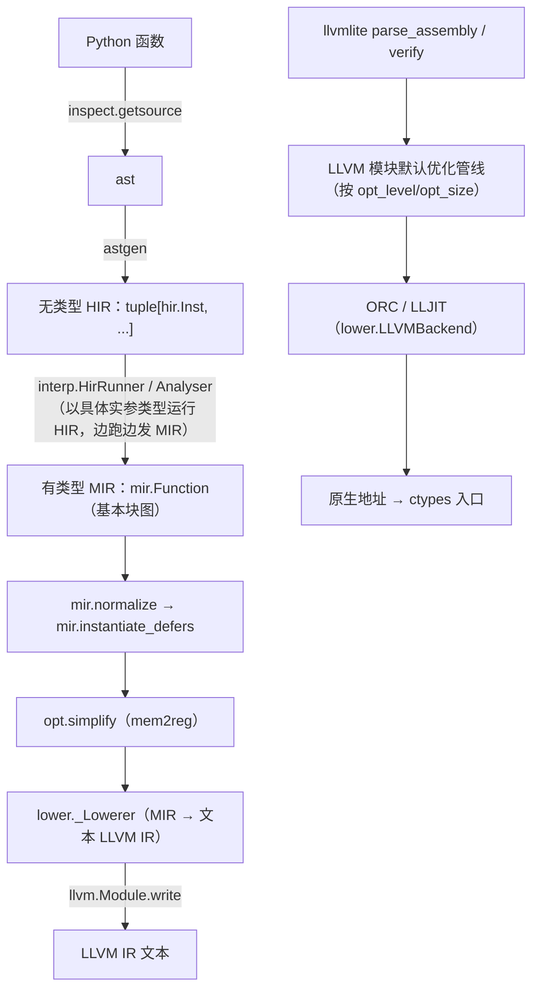

# spy 编译器实现

本文档描述 **当前代码**（`spy/spy/compiler/`）各阶段如何协作，把 Python 源码编译成本地机器码。
可观察行为见 `doc/features.md`；行为规格推导见 `doc/archive/comptime-refactor/behaviour.md`（已归档）。

---

## 0. 流水线总览

两层「类型」贯穿始终：

- **spy 类型**（`sval.Type`）：编译期解释器唯一信任的类型域，决定布局策略、ABI、特化键。
- **MIR 类型**（`mir.Type`）：仅在实际发射/降级时由 `sval.Type.to_mir_type(cache)` 产生。
  解释器**从不回读** MIR 类型做判断（开环）。

---

## 1. 模块地图

| 文件 | 职责 |
|---|---|
| `compiler/__init__.py` | 公开接口：`func`/`struct`/`func_type`/`decl_func`/`typeof` 与各类型常量 |
| `compiler/syntax.py` | 函数体内的语法标记：指针类型、`ref`、`Array`/`array`、`Option`、`Comptime`/`ConstComptime`/`InferComptime`、`typeof`、`unroll`、`comptime()`、`defer` 与 `OK/RAISE/UNWIND/ERR/ALL`、`closure`、`Opaque`、C 整数 marker |
| `compiler/dsl.py` | 装饰器与注册：`_Context`（每宿主编译上下文）、`_RegisteredFn`/`_RegisteredClass`/`_FuncTypeDecl`/`_DeclFuncDecl`、各 Metadata、`IntEnum` 支持 |
| `compiler/astgen.py` | Python `ast` → HIR；签名解析（`parse_function`）、作用域、闭包、RLS、标记识别 |
| `compiler/hir.py` | HIR 指令集与结果位置类型（`ResultLocTree`/`FullResultLoc`/`ReturnLoc`） |
| `compiler/sval.py` | spy 类型系统、编译期值、`Box`/`ComptimePtr`、布局缓存 `MirLowerCache`、返回规格、`as_value`/`coerce_const`、`TypeVarSolver` |
| `compiler/interp.py` | 编译期解释器（`HirRunner`）与编译驱动（`Analyser`）：跑 HIR → 发 MIR |
| `compiler/fn.py` | 签名模型（`Signature`/`CallSignature`/`ReturnSignature`）、`ArgNode`、`FunctionValue`/`FunctionInstance`/`ClosureFunction`、thunk、`SymbolTable`、`CompileBatch`、`OptimizationOptions` |
| `compiler/mir.py` | MIR 类型/值/指令/基本块/终结符；`normalize`、`instantiate_defers` |
| `compiler/opt.py` | 单一优化：把单次存取的 slot 折回寄存器（保守 mem2reg） |
| `compiler/llvm.py` | 纯文本 LLVM IR 构造器（无 libLLVM 调用）；`DataLayout`；JIT 无关 |
| `compiler/lower.py` | MIR → LLVM IR；`LLVMBackend`（唯一使用 llvmlite/JIT 的地方）；LLVM 优化管线；异常展开 landing pad |
| `compiler/glue.py` | Python ↔ spy 边界：ctypes 读写、实例包装、`invoke`、结果脱壳 |
| `compiler/target.py` | `TargetInfo`（指针宽度、C 整数宽度、`usize` 宽度） |
| `compiler/util.py` | 共用工具（`IdentityObj`、`IndexedMap`、`StrBiMap`、`FrozenArraySet`、`TriState`、`frozendict` 等） |
| `compiler/errors.py` | `SpyError`/`CompileError`（带 `loc` 与调用链）/`CoerceError`/`TypeMismatchError` |
| `compiler/source.py` | `SourceFile`/`SourceLoc`/`TraceFrame`；AST 行号映射与诊断格式化（源码片段、caret、`called from`） |
| `compiler/binop.py` | 运算符字面量类型（`UnaryOp`/`BinaryOp`/`CompareOp`/`BoolOp`） |

---

## 2. 前端：`astgen`（Python `ast` → HIR）

### 2.1 `parse_function`

`parse_function(fn, resolver, self_type=None, self_arg="ptr", context_type_vars=None, exceptions=None, callconv='default', may_panic=True) -> FunctionIR`：

1. `inspect.getsource` + `ast.parse`；要求恰好一个 `FunctionDef` 且名字匹配。
2. 拒绝 `posonlyargs`/`kwonlyargs`。
3. 读 PEP 695 `fn.__type_params__` → `sval.TypeVar`；`context_type_vars`（外层 struct 的类型参数）预置。
4. 从对象读 `__annotations__`/`__defaults__`；返回注解归一化（`-> None` → `VoidType`，`-> Never` → `EmptyType`，无 → `None` 表示推断）。
5. 逐个位置形参构造 `fn.SignatureFormalArg`：`Comptime`/`Comptime[T]` 拆成 `is_comptime`；`type[X]` → `is_type_value`；方法接收者（`self_type`）按 `self_arg` 定成 `Ptr[Self]`/`ConstPtr[Self]`/按值。
6. `*args`/`**kwargs`（`vararg_formal`，拒绝 `InferComptime`/`type[...]`）；异常集（`exception_set`）。
7. 组装 `fn.Signature` + `FunctionIR(name, signature, arg_is_ref, ())`。
8. 建 `_Builder`，声明位置形参为 `hir.Arg(i)`，翻译函数体，末尾补 `hir.StoreVoidRetloc()`。

### 2.2 `_Builder`：作用域与声明

- `_Scope` 栈：每个 `vars: dict[str, hir.Value]` 把名字映射到**指向该对象的指针**（slot / option / unwrap payload）。
- `_declare`：只在最内层块绑定。`_lookup`：由内向外扫描，命中后经 `_tunnel_through_closures` 生成捕获链。
- `_lookup_within_function`：扫到最内层 `_ClosureScope`（含）为止，不跨越——决定一个赋值是否**声明**新变量。
- `_gen_body` 会**预先声明一连串连续 `def` 的 slot**（`Alloca`），以便自递归/互递归解析。
- 全局解析 `_resolve_global`：`fn.__globals__` / 内建表；`range`→`std.range`、`StopIteration`→`std.StopIteration`、
  `bytes`→`BytesType()`、`str`→`StrType()`；`ord`/`len`/`isinstance`/`type` 保留为身份标记。
  `_resolve_closure`：先查 `co_freevars`（闭包单元的值作为编译期常量嵌入；未绑定且名字等于函数自身时返回原 `fn`，支持注册期自引用）。
- `_try_resolve_object`：把一个**全局表达式**折叠成其 Python 对象（名字或属性），是所有标记身份识别的骨干。

### 2.3 语句与表达式翻译

| Python | 降级 |
|---|---|
| `if`/`elif`/`else` | `hir.If(AsBool(cond))` … `Else` … `End`；**条件为 `and` 链**时改用 `hir.Block` + `BreakIf`，使条件里 `:=` 绑定的名字支配 body |
| `while` / `while-else` | 死循环 `hir.Loop`，块头重求值条件、为假先跑 `else` 再 `BreakLoop`；`is_inline` 来自 `syntax.unroll()` |
| `for` | 显式迭代器循环：`it = iter.__iter__()`（commit）→ `Loop` → `Try(StopIteration)` → `target = it.__next__()`（commit）→ body → `Except` → `else` + `BreakLoop` |
| `try`/`except` | 子句类型表达式**在 `Try` 之前**求值（`hir.Try.except_types`）；`binds` 是 `as` 名（预建的 `ExceptBind`）；`Try`/body/`Except(i)`/子句/`End`；try-else/finally、无 except、裸 `raise` 报错 |
| `with syntax.defer(...)` | `hir.Defer(flags)` + body + `End`；flags 由 `defer()`/`okdefer()`/`errdefer()` 或编译期整数表达式给出 |
| `match` | 对 tagged union：`case _:` 通配（必须最后）、`case T():`（`IsInstance`）、`case T() as e:`（`TaggedUnionPayloadPtr`）；不支持守卫/子模式 |
| `return` | 有值：`_gen_result_loc(value, ReturnLoc())`；无值：`StoreVoidRetloc()`；随后 `hir.Ret()` |
| `raise` | 新 slot + `_gen_result_loc(exc, slot)` + `hir.Raise(slot)` |
| `assign` | `_gen_lhs`（名字未绑定则声明 `Alloca`）+ `_gen_result_loc(value, result_loc)` + `CommitSlot`；**只处理 `targets[0]`** |
| `annassign` | `_split_comptime` 拆出 `is_comptime`/`is_const`/声明类型；`ConstComptime` 必须带初值；名字不能已绑定 |
| `augassign` | lhs 必须按引用给出（`is_ref`，即一个指针）；发 `hir.BinaryAssign(op, lhs, rhs)` |
| `break`/`continue`/`pass` | `hir.BreakLoop` / `hir.Continue` / 无 |
| 表达式语句 | `_gen_expr` 求值后丢弃（用于副作用/强制编译期求值） |

表达式要点：

- **结果位置语义（RLS）**：`_gen_result_loc(node, result_loc, allow_fall_back=True)` 把结果写进调用方给的**结果位置指针**，不产生寄存器。
  `hir.ReturnLoc()` 表示整棵函数结果位置树（多返回值是一棵指针树）。`_gen_expr` 的 fallback 为需要「值」的表达式分配临时 `Alloca`、RLS 写入、返回该指针。
- **解构赋值**：`_gen_lhs` 对元组目标给出**位置树**（`_gen_target_tuple`）；当 RHS 是元组表达式且目标是位置树时，`_gen_result_loc` 把它**逐元素拆开**（`a, b = c, d` → `a = c; b = d`，长度不符在 astgen 报错），
  因此 `hir.InitTuple`/`hir.TuplePtrElement` 的位置**从不**是树（见 §3；树只可能由 `ReturnLoc` 在解释器中解析出来）。
- **标记识别**（按对象身份）：`_SYNTAX_CALLS = (ref, unroll, comptime, typeof)` → `_gen_syntax_call`；
  语句级标记（`unroll`/`comptime`/`const_comptime`/`infer_comptime`）由 `_as_marker` 缓冲为 pragma，由下一条语句消费（悬空 pragma 报错）。
- 下标 `a[...]`/`a[Literal[X]]`/`Ptr[T]`/`Array[T,N]`/`Option[T]`/`a[b:c]`/`a[i]` 分派见 `astgen._gen_expr`、`_gen_type_ctor`、`_gen_literal`。
- `is None`/`is not None`（`_gen_is_none`）、海牙 `_gen_walrus`/`_gen_unwrap`、`isinstance`（`_gen_isinstance`）。
- 调用 `_gen_call`：`cast`（no-op）→ `array` → `isinstance` → `ord` → `len` → 属性为普通 Python 函数则 `CallInplace`（其 callee 解析成 `sval.PyFunction`，编译期由 Python 求值）→
  属性为方法则 `CallMethodInplace` → 结构体构造 `FinishStruct` → 普通 `CallInplace`。
  `_gen_arglist` 目前**静默忽略 `**kw`、对 `*x` 报错**（`hir.Spread` 已存在但 astgen 未发射，见 `doc/issues.md` #1）。

### 2.4 闭包捕获（`_gen_closure`）

- 捕获在**查找时惰性发生**（`_tunnel_through_closures`）：跨过的每个 `_ClosureScope` 边界把当前的指针追加进 `captures`（按名去重）。
  读者自己那层发 `hir.FieldIndexAddr(hir.Arg(0), index)`；中间层发 `_CaptureField(index)` 标记，最后由 `_gen_closure` 物化成字段访问。
- `_gen_closure` 在**外层流**里求值闭包的注解/默认值/返回注解，建 `fn.ClosureFunction`，push `_ClosureScope`，
  把形参绑到 `hir.Arg(i+1)`（`Arg(0)` 是闭包自身的匿名 struct），最后发 `hir.MakeClosure(...)`。
- `_gen_function_def` 把闭包值存进该名字的 slot；`_gen_lambda` 是强制内联、body 为 `RLS(body, ReturnLoc())` + `Ret()` 的闭包。

### 2.5 源码位置与诊断

- `source.source_of_object(fn/cls)` 用 `inspect.getsourcelines` 取原始源码（含装饰器），在 `textwrap.dedent` 后解析，再用 `ast.increment_lineno(tree, start - 1)` 把所有节点行号变成**原始文件行号**。`SourceFile` 保存原始行、dedent 宽度和起始行；`SourceLoc` 是 1-based、end 指向范围之后的半开区间。
- `parse_function` 把 `SourceFile` 交给 `_Builder`；`_Builder._gen_stmt`/`_gen_expr`/`_gen_result_loc` 用 `_at(node)` 维护当前节点，`add()` 把当前位置写进 `hir.Inst.loc`。`CompileError.attach_loc` 只在空位置时写入，所以最内层节点优先；`sval` 等中间层不需要位置参数。
- `interp._step` 把当前指令的 `loc` 补到 `CompileError` 上；`Analyser._run` 在错误穿过 `_analyse_stack` 时，按“内层到外层”把每个 `HirRunner` 的当前指令位置追加为 `called from` 帧（同一 runner 的内联 `InlineFrame` 也按此顺序展开）。参数转换错误优先用实参值指令的 `loc`。
- `CompileError.__str__`/`format()` 输出 `path:line:col: error: ...`、覆盖 `SourceLoc` 整个范围的源码片段与 caret，以及 `note: in function ...`/`note: called from ...` 调用链；`args[0]`/`message` 仍是原始消息。
- 在 IPython/Jupyter 中，`source.format_location` 通过 `CachingCompiler.format_code_name()`（后备 `_filename_map`）把 cell 的临时文件路径映射为 `In[N]`，主位置和 `called from` 帧都使用它；普通脚本和 import 的模块仍显示真实路径。
- `dsl._build_fn_type` 和 `_RegisteredClass.get_entry` 的位置来自函数/类的声明源码：参数错误指向注解节点，struct 字段错误指向字段注解。

---

## 3. HIR（`hir.py`）

线性无类型指令流；每个 `Inst` 对象**自身即一个结果寄存器**（身份相等），并携带生成它的源码位置 `Inst.loc`（见 §2.5）。

- `Value` 基类；`Const(value)`（字面量/不可变全局值）；`Arg(index)`（第 index 个参数的**地址**）。
- `ReturnLoc`（**不是** `Value`）；`type ResultLocTree = hir.Value | tuple[ResultLocTree, ...]`；`type FullResultLoc = ResultLocTree | ReturnLoc`。
- 指令：`Alloca(is_comptime, is_const, type)`、`Load`、`Store(ptr, value)`、`StoreVoidRetloc`、`CommitSlot(slot)`；
  `FieldAddr`/`FieldIndexAddr`（`is_aggregate_init`）、`FinishStruct`/`FinishArray`、`InitTuple`/`TuplePtrElement`（位置是 `Value | ReturnLoc`，从不是树，见 §2.3）、`Tuple`/`Dict`；
  `CallInplace`/`CallMethodInplace`（带 `ret`）、`CallArgs`/`Spread`；
  `Subscript`/`Slice`/`PtrCast`/`AsFuncPtr`/`TypeOfBegin`/`TypeOfEnd`；
  `Binary`/`BinaryAssign`/`Compare`/`Not`/`Unary`/`Ord`/`AsBool`/`Len`/`IsNull`/`OptionPayloadPtr`/`IsInstance`/`TaggedUnionPayloadPtr`；
  `If`/`Else`/`Loop`/`Block`/`BreakIf(cond, levels)`/`BreakLoop`/`Continue`/`End`；
  `Defer(flags)`/`Try(binds, except_types)`/`Except(index)`/`ExceptBind`/`Ret`/`Raise`/`MakeClosure`。
- `DeferPath(IntFlag)`：`OK=1`、`RAISE=2`、`UNWIND=4`、`ERR`、`ALL`。
- 块扫描：`scan_block`（返回 `Else`/`End` 位置）、`scan_try`（返回各 `Except` 与 `End` 位置）——因为 HIR 是扁平流、无嵌套结构。

---

## 4. 类型与值系统（`sval.py`）

### 4.1 一个类型两种角色

每个 spy 类型既是**注解值**，也是编译期可用的**值**。相等性大多是**结构化**（frozen dataclass），
少数是**身份**（`IdentityObj`）：`TypeVar`、`StructType`/`StructTypeHead`、`IntEnumType`、`Box`、`FunctionValue`。

### 4.2 `SpecialTypeKind` 与 `classify()`

`Type.classify()` 只由类型本身决定（不看 MIR）：

| kind | 含义 | 有 MIR 镜像 | 有存储 |
|---|---|---|---|
| `NONE` | 普通运行时类型 | 有 | 有（除非 ZST） |
| `COMPTIME` | 纯编译期，无运行时表示 | 无 | 无 |
| `ZST` | 零大小（单位）类型 | 无 | 无 |
| `DST` | 动态大小：只有**指向它的指针**是值 | 无（只有 `fam_mir_type`） | 无 |

派生：`is_zst()` = `classify()==ZST`；`is_copyable()` = `classify()!=DST`（容器覆盖）。
关键类型：`IntType`（按 range 子类型；整型是浮点的子类型，当其整个范围落在该浮点的精确整数范围内，见 `float_exact_int_range`）、`FloatType`（窄→宽子类型）、`BoolType`、`ComplexType`、
`PointerType`、`ArrayType`、`OptionType`、`TupleType`、`StrDictType`、`StructType`、`UnionType`、`TaggedUnionType`、
`ResultType`/`Success`、`FunctionType`/`AnyFunction`/`DeclareFunction`、`IntEnumType`、
`TypeType`/`AnyType`/`TypeVar`/`BytesType`/`StrType`/`EmptyType`/`VoidType`/`NullType`/`TypedNull`/`UndefinedType`/`ValueType`/`OpaqueType`。

### 4.3 值域与 `Box`

- `AnyValue = Value | int | float | complex | bytes | str | bool`；`ScalarValue` 是能占 `Box` 一个 cell 的子集
  （聚合值形式 `AggregateValue`/`TaggedUnionValue`/`UnionValue`/`OptionValue`/`TypedNull`/`UndefinedAggregate` **不**在其中，`is_scalar_value` 判定）。
- `Box(name_base, type, is_const, cells)`：身份对象，把值**铺平**为 `list[ScalarValue]`；`reset(type)` 按 `scalar_leaves` 初始化每 cell 为 `UndefinedScalar`。
- box 读写 helper（均在 `sval`，`interp` 直接读写 `Box.cells`）：`flatten_value`（含 padding；`undefined` → 每叶 `UndefinedScalar`）、
  `unflatten_cells`（其逆）、`fill_comptime_defaults`（把 `is_comptime` 字段填默认，迭代）、`load_box_cells`（`bytes`/`str` box 特判）。

### 4.4 结构体布局（`StructType._calculate_mir`）

1. 收集有存储的字段：跳过 `is_comptime`；`is_ref` → `*const T`（ZST pointee 跳过）；跳过 ZST；
   第一个 DST 字段成为 FAM（后续 DST 不占位）；其余用 `field.type.to_mir_type`。
2. `extern_c` 保持声明顺序；spy struct **按对齐升序排序**。
3. 建 `_field_mir_indices`（ZST 字段 → `None`，FAM → `len(mirrored)`）。
4. `_mir`：无镜像字段且无 FAM → `None`（零大小）；恰好一个镜像字段、非 `extern_c`、无 FAM → **该字段自身的镜像**；
   否则 → `mir.StructType`。

`StructField(name, type, default, is_comptime, is_ref)`；`StructModifiers(extern_c, copyable)`；
`StructTypeHead.specialize(args)` 记忆化每个特化（保证 `typeof(x)==Foo` 有意义）。

### 4.5 指针与 `ComptimePtr`

- `PointerType(elem, is_const, variant)`：元素相同才可转换；`_points_at_elements_of`（`*[N]T` → `T` 的多指针）；
  只能**加** const；peer 的 const 性用 `_peer_const`。`to_mir_type`：ZST/Opaque pointee → `void*`；无长度数组 pointee → 元素指针。
- `ComptimePtr(box: Box | bytes | str, offset: int, type: PointerType)`：结构化 eq/hash → **自身即特化键**（同一 box + offset + 视图类型）。
- `pointer_object_type(ptr)`：指针**所指的对象**——pointee 本身；若它指向的是 `box` 那个数组的元素（`offset` 处、元素类型相同），则是该数组**从该元素起的尾部**（元素下标 = `offset // scalar_count(elem)`，长度 = `length - 下标`）。物化时按它生成存储，才留得住「后面还有多少个元素」（见 §6.5）。
  `is_writable()` 要求视图非 const、box 非 `bytes`/`str`、`Box.is_const` 为假。
- `CastedPtr(ptr, type)`：`ptr_cast` 重解释后的编译期指针；不能读写透。

### 4.6 布局缓存与特殊类型（`MirLowerCache` / `SpecialTypes`）

`MirLowerCache` 为每个宿主/目标记忆化必须唯一化的镜像：`tuple_struct`（位置字段 `_0,_1,…`）、`strdict_struct`（字段=条目名）、
`union_mir`、`option_struct_mir`（`{tag, value}`）、`tagged_union_mir`、`complex_mir`。
`SpecialTypes` 保存 `std.core.slice`/`SlicePtr`/`ConstSlicePtr` 等本应由 `std` 提供的类型（每宿主一份）。

结构辅助（多为迭代实现）：`alignment_of`、`aggregate_type_length`、`scalar_leaves`（铺平 = 值占的 cell 序列）、
`scalar_count`、`field_scalar_offset`、`find_first_pointer_type_pos`（option 借用的指针位置）、`tagged_union_shape`、
`_union_cell_width`。

### 4.7 返回规格与 ABI

- `returns_via_result_ptr(type)`：不可拷贝 → True；聚合中提到 `TypeVar` → False（假定小）；无镜像 → False；否则 `estimated_size_of(mir) > 16`。
- `pass_by_ref(type) -> TriState`：提到类型参数 → `UNKNOWN`；不可拷贝/DST/COMPTIME → TRUE；ZST → FALSE；否则 MIR 大小 > 16。
- `RetSpec = RetValue | RetTuple | RetComptime`：`RetValue(type, via_result_ptr)`、`RetTuple(type, values)`、
  `RetComptime(type, index)`（无 slot、无 result 指针，编译期交付，`index` 是在所有 `RetComptime` 叶中的序号）。
- `result_leaves(type)`：把 `tuple[...]`/`ResultType[...]` 展平成叶（迭代）；`make_ret_spec(type, cache, force_by_value)`：
  选出唯一「按值」叶（首个非 COMPTIME、非 ZST、且 `force_by_value` 或 `!returns_via_result_ptr`），其余经 result 指针，重建 `RetTuple`/`RetValue`/`RetComptime` 树。
- `FunctionType.ret_spec` 在声明异常时先把 `return_type` 包成 `ResultType`，`force_by_value = callconv != 'default'`）。
- `ResultType.tag_bits`：有正常返回值时 tag 是 `0..n`（`0` = 无错误），宽度 `n.bit_length()`；值部分是 `EmptyType`
  （无 `return` 路径）时没有「无错误」码，第 i 个异常的 tag 就是 i（单个异常时错误码是 `u0`，调用点直接静态分派）。

### 4.8 常量与类型变量

- `as_value(obj, ctx, type_vars)`：Python 对象 → spy 域（内建类型别名、`TypeVar`→已解值、`TypeAliasType` 解包、`StructTypeApplication` 特化、
  `|` 链 → `OptionType`/`tagged_union_of`、`tuple[...]`/`Literal[X]`/指针 marker/`Array[T,L]`/`Option[T]`/`Union` 等）。
- `coerce_const(value, type)`：把**任意**编译期量具体化成类型常量，失败抛 `CoerceError`。覆盖：
  `UntypedUndefined`/typed undefined（`_typed_undefined`，是 option/union 的成员时包成 present）、`Any`（任意值原样）、
  `ComptimePtr`（一个指针值：pointee 相同即可作指针常量；指向数组的指针还可转成**元素的多指针** `*[N]T -> mptr T`，`_points_at_elements_of`，此时视图按目标重定型（地址相同、按元素看））、`AggregateValue`（只能是自身类型）
  与各种聚合/union/complex/option 值形式、函数值（作函数指针）、枚举成员、整数 range 检查，整数→浮点常量按**值**（而非按类型范围）的精确性检查（`int_to_float_is_exact`，见 §6.1），以及「自身类型即目标且该类型是编译期专属」的值；
  `coerce_const_tagged_union` 负责变体选择与 tag 重映射。
- `TypeVarSolver`：约束求解（相等/子类型、结构分解 `StructType`/`OptionType`/`PointerType`/`ArrayType`、`finish` 折叠子类型界）。
- `replace_type_var(s)`：结构替换（含 `StructType` 经 head 重新特化以保 identity）。
- `type_of(value, int_literal_bits)`：边界处的 Python 值 → spy 类型（`int` → `AnyIntType` 或 `IntType(bits, True)`）。

### 4.9 特殊类型的镜像

- **Option**：借用 `T` 里第一个未被内层 option 占用的指针当「缺席」标签（`find_first_pointer_type_pos`），
  因此 `Option[Ptr[T]]` 与 `Ptr[T]` 布局一致；`T` 是 ZST 时只有一位 `bool`；否则 `(bool, T)` 结构体（`option_struct_mir`）。
  借用式表示下，若 `T` 自身把该指针位置表示成空值，会被误读为外层缺席。
- **tagged union**：单变体 → 该变体自身的镜像；多变体 → `tag + payload union`（`tagged_union_mir`），
  payload 存最大变体，ZST 变体不占 payload。
- **整数枚举**：默认取能容纳所有成员值的最小整数类型（有负值改有符号），如 `{0,1,2}` → `u2`、`{-1,0,1}` → `i2`；`@enum(...)` 可手动指定（如 `c_int` 对齐 C ABI，`i0`/`u0` 为 ZST）。空枚举报错。
- **复数**：`{real, imag}` 两个元素浮点（`complex_mir`）。
- **无标签 union**：存储即最大变体，各变体都在偏移 0（见 §7.1）。

### 4.10 peer 规则（`resolve_peer_type`）

- `Type.resolve_peer_type(other)`：两个类型的**共同类型**（最小上界）——任一方的值可转换成的那个类型，无共同类型时 `None`。
  它给「未声明类型的存储」定型（`interp.PendingSlot.committed_type`、`interp._common_element_type`、`_build_tuple_value` 都是**从左到右**折叠），
  也是 `std.core.lub_type` 的实现。
- 阶梯（自上而下）：**两个 bottom**（`UndefinedType`、`EmptyType`）是单位元（对方胜出）；`NullType` 把对方变成 `Option[T]`；
  `OptionType` 穿透到 child；变体与含它的 `TaggedUnionType` 互为 peer；其余比对**双向**子类型（`self ⊑ other → other`，
  `other ⊑ self → self`，都不成立 → `None`）。
- 各具体类型的覆写只保留「同族合并」，其余一律回落 `super()`（基类负责 bottom/null/option/union/双向子类型）：
  整数取最小可容纳两者的类型（`min_int_type`）、浮点取较宽者、指针要求 pointee 相同且 const 相加/降为单指针、
  实参与复数的转换由 `ComplexType` 一侧决定（实数 → 零虚部；两个复数 → 加宽元素浮点）。
- 两个 bottom 相碰取规范的 `undefined`（`UndefinedType` 特判 `EmptyType → self`）；`EmptyType` 正是 `TypeVarSolver.finish` 折叠的初值。
- `null ⋄ void` 是 `Option[void]` 而**不是** `void`：`None` 仍可用在要求 void 值的位置，但那是 `coerce_const` 的转换；
  若 peer 到 `void`，则 `null`、`void` 与含 `void` 变体的 union 三者的折叠将不再结合。同理 `null` **不是**任何 union 的变体。
- **唯一不对称**的是 `ResultType ⋄ ResultType`：取左侧的返回类型、左侧的异常在前（这正是调用方折叠顺序所依赖的），
  所以 `lub_type(t1, t2)` 对 result 类型按参数顺序敏感；其余所有类型满足 `a ⋄ b == b ⋄ a`。
- 注意 `ValueType`（字面量类型）目前无任何构造点（`_type_of` 的 `allow_value_type` 参数从未被传 `True`），
  它的 `resolve_peer_type`/`IntType` 的 `case ValueType()` 分支都是死代码。

---

## 5. 函数模型（`fn.py`）与声明 DSL（`dsl.py`）

### 5.1 签名

- `SignatureFormalArg(type, is_comptime, default_value, by_ref: TriState, is_type_value)`：
  注解可为 `TypeVar`（未定）、`by_ref=UNKNOWN` 留待特化决定。
- `Signature(generic_args, positional, varargs, kwargs, ret_type, exceptions, callconv, may_panic)`：
  - `bind_arg_pos(RawArgList) -> ArgList`：Python 式绑定（位置→形参、关键字按名、剩余→`*args`/`**kwargs`、缺省→默认值转换器）。
  - `solve_param_types(provided)`：用 `TypeVarSolver` 从实参树（`ArgNode`）解出类型参数；
    `type[X]` 形参把实参类型本身作为 `X` 的界；未解出报 `TypeMismatchError`。
  - `specialize(provided, cache) -> (CallSignature, PartialReturnSignature)`：先解类型参数并替换，再逐个 `resolve`：
    ZST 实参 → 单位值（不占 MIR）；`Comptime` 或铺平叶 → `coerce_const`（编译期值）；by-ref 由 `TriState.or_(hint, pass_by_ref(type))` 决定；
    最后定返回规格（C 约定强制按值、拒异常、拒不可拷贝）。
  - `substitute_type_vars`：给泛型 struct 的方法代入 `self` 的结构类型参数。
  - `as_non_generic_fn_type` / `signature_of_fn_type`：签名 ↔ 函数**指针**类型互转。
- `_c_default_promotion`：C 变参的默认实参提升。

### 5.2 表示

- `FunctionIR(name, signature, arg_is_ref, body)`。
- `FunctionValue(name_base, hir, force_inline, specs, failed)`：**身份对象**，兼作该函数在本宿主的入口；
  `get_type()` 返回 `PointerType(fn_type, is_const=True)`（`fn_type` 来自签名，未定向时为 `AnyFunction`）。
  `specs` 是 `CallSignature → FunctionInstance` 的缓存（递归/前向引用的解析点）。
- `FunctionInstance(mir, ret_sig, wrapper_fn, native_fn, call_sig, thunk_call_sig, thunk_ret, ret_comptime_values)`：
  一个特化的编译产物；`ret_comptime_values[index]` 是该 `RetComptime` 叶的值（最后一条被分析的 `return` 胜出）。
- `ClosureFunction`：一个嵌套 def/lambda 的解析结果（声明形参 + 捕获分开；捕获成为闭包匿名 struct 的字段）。

### 5.3 thunk（Python 入口桩）

ctypes 不能按值传聚合，故 `_make_thunk` 为每个特化生成一个 MIR 函数：聚合形参收成指针再 `Load`；
每个存储叶经一个尾部 `$result` 出指针交付，最后再追加一个隐藏的 `$unwind: Ptr[PanicData]`，即 `UnwindException.data` 的存储地址。
thunk 经 `mir.CatchUnwind` 调用值形态；捕获到的 `PanicData` 用 typed `Load`/`Store` 拷进 `$unwind`，`mir.EndCatch` 释放 C++ 异常对象，
thunk 返回 `bool`（`true` = panic，`false` = 正常）。`_thunk_call_sig`/`_thunk_ret` 描述 glue 要 marshaling 的形态。
`native_fn` 是「值形态」（spy 互调/`ExternAnonSymbol` 解析用），`wrapper_fn` 是 thunk（Python 边界用）。

### 5.4 编译驱动

- `SymbolTable`：进程级 **link name ↔ NativeFn** 映射；跨模块调用靠它把 `ExternAnonSymbol` 解析回已分配的名字。
- `CompileBatch`：一批 `FunctionInstance` 一起编译——先建 thunk，收集符号（`mir.collect_symbols`），`opt.simplify` 每个 body，
  `SymbolTable._assign_names` 分配链接名，`backend.compile(structs, globals, target)`。`compile(..., resolver)` 从 `resolver.target_info()` 取 target，
  并在本轮有新实例时 lazy 解析 `std.core.PanicData`，把它的 MIR 类型传给 `_make_thunk`（该类型不保存在 batch 上）。
- `Backend.compile(structs, globals, target) -> dict[mir.GlobalValue, NativeFn]`：真实实现是 `lower.LLVMBackend`。

### 5.5 `dsl`：注册与每宿主上下文

- 装饰器工厂（`func`/`func_type`/`decl_func`/`struct`）各返回一个句柄，并在 `_Context` 的缓存里登记（同一装饰对象→同一句柄）。
- `_RegisteredFn`：`__call__` 是 Python 侧调用（解析→绑定→`specialize`→`Analyser`→`CompileBatch`→`glue.invoke`）；
  `__get__` 实现描述符协议（类访问得到句柄、实例访问得到 `partial(self, instance)`，从而 `Foo.m(x,…)` 不隐式传 `self`、`x.m()` 传）。
  `get_entry` 惰性解析：`self_arg` 默认按类型决定（枚举 → `"value"`，struct → `"ptr"`）。
- `_RegisteredClass`：`get_entry` 建 `StructTypeHead`（先绑 head 再读 body，支持自引用）、字段、方法（走 `reversed(MRO)`，子类覆盖优先）；
  `__getitem__` → `glue.specialized_struct`；`__call__` → `glue.construct`。
- `_Context`（`sval.CompileContext` 子类）：`resolve_global`（把注册对象/enum 成员解析成本上下文的 spy 值或 `FunctionValue`，把不用 `@func` 装饰的普通 Python 函数包成 `sval.PyFunction`）、
  `special_types`、`mir_lower_cache`、`target_info`、`_resolve_call`、enum 支持（`enum` 装饰器/`_int_enum_type`/`_collect_enum_methods`/`enum_class_of`）、
  编译选项（`get_compile_option`/`set_compile_option`，由 `_compile_options` 以 `str` 名为键存）。
  `GLOBAL_CONTEXT = _Context(LLVMBackend())` 是顶层默认上下文。

---

## 6. 编译期解释器（`interp.py`）

这是编译器的心脏：以具体实参类型**逐条运行** HIR，边跑边发 MIR。

### 6.1 一切皆值

- `InterpVal = sval.AnyValue | RuntimeVal | PendingSlot`；`FullInterpVal = InterpVal | tuple[FullInterpVal, ...]`（*位置树*，多值 `ResultLocTree` 解析得到的形态）。
- HIR 之后只有值：一个名字/字段/下标的求值结果就是一个**指针值**（类型 `PointerType`），`astgen` 在需要「值」的地方插入 `hir.Load`（`_as_value`）、
  在需要指针的地方物化一个（`_as_ref`），所以解释器里没有「place / 值」之分。
- 编译期值**就是**直接持有的 `sval.AnyValue`（判定用 `sval.is_sval`；「无值」用 `Void()`、源码 `None` 用 `Null()`）。
- `RuntimeVal(value: mir.Value, type: sval.Type)`：只保留 spy 类型；MIR 类型按需由 `to_mir_type` 产生。
- `PendingSlot`：已执行但未 commit 的 `hir.Alloca`（见 §6.2）。
- `ComptimeResultPtr(value, code, payload)`：函数结果位置的指针形态（value/code/payload 三个位置），**不是** `InterpVal`。
- 判定：`_is_comptime_val`（`RuntimeVal` 一律不是；旧的「不引用寄存器」放宽已删除）、`_place_is_comptime`、`_references_register`。
- `_coerce(ev, target)`：store、实参、返回与 `std.core.coerce` 共用的**隐式转换**。**编译期量一律交给 `sval.coerce_const`**（一个 `sval` 编译期值，含 `ComptimePtr` 这种指针值），所以编译期量是按**值**收窄的；
  运行期量只有 `src.is_subtype_of(target)`（同类型或拓宽）才放行，否则抛 `CoerceError`——即整数收窄、**有损**的整数→浮点、`f64 -> f32` 都是运行期编译错误；整数→浮点在其**无损**时才隐式（运行期由 `IntType.is_subtype_of` 判断整个类型范围是否落在 `float_exact_int_range` 内；编译期由 `coerce_const` 按值的**实际精确性**判断，见 `int_to_float_is_exact`，所以 `±2**53` 之外的 2 的幂也合法——运行期与编译期的规则并不相同）
  （显式形式 `std.int.truncate`、`std.int.int_cast`、`std.float.float_truncate`、有损的 `std.int.int_to_float` 各自经 `_convert_inst` 构造 `mir.Convert`，收窄与有损转换仍在那里发生）。`CoerceError` 由 `_try_coerce` 吞掉。
  `Option`/`TaggedUnion`/`Tuple`/`StrDict`/`Complex` 的目标分支只处理运行期值。

### 6.2 Compile-time 存储与 pending slot

- `PendingSlot(insertion, is_comptime: bool | None, is_const, runtime_pos, stores: list[_PendingAction], committed, declared)`：
  - `committed_type()`：优先 `declared`，否则把各 action 的 `info()[0]` 用 `resolve_peer_type` **从左到右**折叠（不兼容则报错；规则见 §4.10）。
  - `use_comptime_storage()`：`is_comptime` 固定时用它，否则「所有写入都是 inline 编译期值」才为编译期。
- `_PendingAction` 变体：`_PendingStore`、`_PendingPtrConvertion`、`_PendingTuple`、`_PendingAggregate`、`_PendingErrorCodeWrite`。
- 记账：`_record_pending_store`（拒绝运行时值进 `is_comptime=True` 槽；`is_inline = 未跨运行期块 且 是编译期值`）、`_record_pending_action`。
- commit：`_commit_pending_slot` → 编译期（或 ZST 仍需要一个指针来寻址）走 `_commit_box_slot`，DST 报错，否则发 `mir.Alloca` 走 `_bind_slot`；
  `_exec_pending_action` 按变体交付（`_store_into_element` 应对 option 层/就地写）；`_PendingAggregate` 投递前先 `_peel_option_layers`
  剥掉 option 层（`Option[U]` 里的构造，`field_index_addr` 的 `is_aggregate_init` 路径共用），落点是 tagged union 时再设 tag + 写变体；
  零尺寸 child 的 option（表示就是一个 tag）也照样置 present——`_option_payload_ptr` 写 tag，`finish_struct`/`finish_array` 的已物化路径对零尺寸聚合补一次剥层。
- **`_is_union_delivery`**：运行时存储里的 tagged union，每次构造记自己的 `_PendingAggregate`（`field_index_addr` 不复用已记录的字段指针），
  故 `if` 表达式两分支构造不同变体也各按自己的变体在各自位置交付；编译期 `Box` 只装得下一个变体，那种情形仍是 `incompatible types` 错误。
- `Box` 存储：读写 helper 在 `sval`（`flatten_value`/`unflatten_cells`/`fill_comptime_defaults`/`load_box_cells`，见 §4.3），`Box.cells` 由 `interp` 直接读写。
- **`mir.Insertion`** 是「在我已经走过的地方发射指令」的机制：`PendingSlot.insertion` 预留 alloca 的位置，
  `_PendingPtrConvertion`/`_PendingErrorCodeWrite` 预留交付/抛出点的位置；`mir.normalize` 稍后拼接。

### 6.3 字段与元素寻址

- `field_index_addr(ptr, index, is_aggregate_init, at=None)`：不额外解引用（基类型就是指向容器的指针）；`is_aggregate_init` + 未 commit → 复用记录的元素指针或新 alloca
  （运行时存储的 tagged union 不复用，见 `_is_union_delivery`）；
  穿过外层 option 构造（设 tag；零尺寸 child 只写 tag）；ZST 字段 → 无存储地址；编译期 box → `sval.ComptimePtr(box, offset+field_scalar_offset)`（`is_ref` 字段返回 cell）；只读编译期 box 的运行期数组下标 → 先用 `_comptime_pointer_value` 物化成全局常量再 `mir.Gep`（可变编译期 box 则报错）；
  运行时 → `mir.Gep`（或 `mirror_is_a_field` 时该值本身）。
- `exec_field_name_addr`：按名解析字段（**自动解引用**）；`ComplexType` 的 `real`/`imag` 也当字段。
- `_comptime_field_place`/`_const_box_place`：`is_comptime` 字段的读写指针（编译期 struct 是 box cell；运行时 struct 是只读常量）。
- `operand`：解析 `Const`（类型参数值 / 全局 / `as_value`）、`Arg(index)`、`Inst`（寄存器表）。
- `subscript`（大分派）：数组/元组/字典/`$args`/`$kwargs`/字符串（`bytes`/`str`）/指针/切片/结构体 `__spy_getitemptr__`/结构体模板特化。
- `_subscript_pointer`：切片 → `SlicePtr`；多指针 → 元素的 place——**单**指针（地址 `p + i`），编译期则取 `box` 中该元素的 cell。
- `std.core.ptr_cast`（`_builtin_ptr_cast`/`_ptr_cast_value`）：运行时指针 → `mir.BitCast`；编译期 `ComptimePtr` 是其子类型 → 重定型；否则 `sval.CastedPtr`；字符串指针 → 指向字节/文本 store。

### 6.4 调用

- `call(callee, args, ret, on_return)`：`FunctionValue`/`BoundMethod` → `_call_function_entry`；`BuiltinFn` → `_call_builtin`；
  `PyFunction` → `_call_py_function`（实参必须是能降为普通 Python 对象的编译期量，`str`/`bytes` 原样传递，返回值就是该编译期值本身、写进结果位置）；
  指向含 `__call__` 结构体的指针 → `call_method('__call__')`（闭包）；指向 `FunctionType` → `_call_fn_ptr`。
- `_call_function_entry`：`substitute_type_vars` + `bind_arg_pos` + `_check_comptime_args`；`force_inline` → `_start_inline`，
  否则 `specialize` 后 `_request_function`（返回 `SUSPEND`，由 `Analyser` 排程）。
- `_start_inline`：内联深度上限 64；绑定形参（`_inline_arg_place`，用 callee 注解声明 slot）、附加 `$args`/`$kwargs` 合成 struct；
  建 `InlineFrame`，其 `ComptimeResultPtr` **共享函数本身**的 error 位置——体内错误沿函数自身的路径离开。
- `_make_runtime_call`：按 `ArgNode` 树与实参配对；编译期叶不传；`is_ref` 实参按指针传；按 `may_panic` 决定 landing pad；
  有错时分配 code 位置（`_check_call_error` → `mir.Switch`）。
- `_deliver_result`：把 `RetSpec` 与调用方的**结果位置指针树**配对（`_pair_places`）；单个结果指针接多值则**打包**——每个结果元素一个 fresh 指针，
  嵌套分组是一个记录了自身元素指针的 slot（`_fresh_places`/`_PendingTuple`），故打包出的元组保留嵌套（`_deliver_packed_tuple`）；
  逐叶交付（`RetComptime` 取 callee 记录的值、`via_result_ptr` 追加出指针、ZST 存单位值、否则按值存）。
- `Analyser`：持有显式 runner 栈（`_analyse_stack`，非递归）。`_request_function` 分四种情形：
  已在 `specs` 且有 `native_fn`（早先模块）→ `ExternAnonSymbol`；在 `specs` 且 `mir.is_complete`（本轮）→ 模块内 `mir.Function`；
  在 `specs` 但未完成（递归）→ 需已声明返回类型，否则报错；否则新建 `mir.Function` + `FunctionInstance`、push runner、返回 `None`（调用方挂起）。
  `_run` 迭代泵完 runner 栈后 `finish()` 并 resume 调用方。

### 6.5 闭包与函数值

- `exec_make_closure`：在外层求值注解/默认值 → 具体 `Signature`；建匿名 struct（字段=捕获，`__call__`=闭包体 + `self` 指针）；
  编译期捕获烘成字段的 `is_comptime` 默认值（`move=False` → `is_ref` 指针；`move=True` → 值），运行时捕获是普通字段（指针或拷贝）；用 `_aggregate_place` 构造实例。
- `std.core.as_func_ptr`（`_builtin_as_func_ptr`）：`T` 忽略；`DeclareFunction` 已是指针；否则闭包必须 **ZST** 且非 `force_inline`；
  `_as_func_ptr_wrapper` 建一个无 `self` 的函数（先 `typed_undefined` 携带类型级捕获，再调 `__call__`），并即时编译以支撑自动 lower。
- 自动 lower：`_to_runtime` → `_comptime_value_to_runtime`/`_comptime_pointer_value`/`_function_value_to_mir`；
  `_const_to_mir` 家族（`_const_pointer_to_mir`/`_const_struct_to_mir`/`_const_tuple_to_mir`/`_const_option_to_mir`/`_const_array_to_mir`/`_const_tagged_union_to_mir` 等）
  产生可用于全局初始化器的静态常量。
- 编译期指针物化时按**指针所指的对象**（`sval.pointer_object_type`，见 §4.5）生成存储：非 const 视图 `alloca` 整块后拷入、再按视图重定型（`mir.BitCast`），
  const 视图的全局常量同理；视图比该对象窄时结果就是该对象的地址（`p` 指向的数组元素、`p[1]` 起仍在其内）。

### 6.6 聚合

- `finish_struct`：解析 struct 类型（模板特化或从目标/字段推断 `_infer_struct_generic_args`）、按声明序绑定位置/关键字实参、
  缺省取默认值；未 commit 的目标记录 `_PendingAggregate`（同一 slot 第二次构造只补默认；不同类型报错——运行时存储的 tagged union 例外，
  每次构造记自己的 action，见 `_is_union_delivery`）；已物化的目标对零尺寸聚合补一次 `_peel_option_layers`。
- `finish_array`：长度取元素个数，元素类型取存储或共同类型。
- `init_tuple`/`tuple_ptr_element`：未 commit 目标记录 `_PendingTuple`（元素是新 slot）；已 commit 目标直接寻址元素；嵌套作为**位置树**（`FullInterpVal`），由 `TuplePtrElement` 寄存器承载。位置树只可能来自 `ReturnLoc` 解析出的多值返回位置（见 §2.3）。
- Option/tagged union/complex 各有 `_option_*`/`_tagged_union_*`/`_complex_*` 辅助。

### 6.7 控制流与错误

- `_exec_if`：编译期条件只发射选中分支；运行时走 `_exec_runtime_if`（两分支 + 汇合）。
- `_exec_loop`：运行时循环发 `Jmp(header)` + `LoopBlockData`；`is_inline` 循环**无回边**——`_unroll_inline_loop` 把 fall-through/`continue` 重定向到下一轮 body 入口并回退 `pc`，超过 `max_loop_unroll`（1024）报错。
- `_exec_block`/`_exec_break_if`：块的出口**只在真有路径到达时**才创建（创建出口即标记块后代码可达）；编译期为假的 `BreakIf` 故意不创建。
- defer：`_exec_defer` 把 body 发进**分离的模板块树**、登记到区域 defer 列表；`_collect_exit_defers` 跨内联帧由内向外收集（`UNWIND` 例外：panic 出 defer body 先跑内层再停）；`_append_defers`/`_normal_defers` 反序、按 `flags` 触发。
- 错误：`_raise` = `_dispatch_exception` + `_cut`；`_dispatch_exception` 找捕获子句（跨内联帧）、收集 `RAISE` defer、路由到子句或写进函数自身 error 位置；
  `_add_function_exception`（声明集外拒绝、推断集增长）；错误码写入推迟（`_defer_error_code_write`，`_finish_function` 填上）。
- `_cut`：路径结束时的展开器（循环 `block_stack`）：空栈 → 函数 proper `DONE`（park `pc`）/`_pop_frame`；defer body 未完成报错；typeof 未产值报错；
  try → 下一个活子句或继续；loop → inline 下一轮或出口块；plain block → 出口块；if → 选中的 pop 或类型化 else 再汇合。
- `typeof` 探针：`_exec_typeof_begin` 切到**分离的** MIR 块（不接入 CFG）；`_exec_typeof_end` 读取被探测值的 spy 类型、丢弃该块、存为该编译期类型值。

### 6.8 内建与运算符

- `_call_builtin` 按 `fn.name` 分派：`compile_log`、`type_info`、`reify`、`undefined`、`layout_of`、`panic`、`catch_unwind`、
  `compile`、`const_array`、`bitcast`、`ptr_cast`、`as_func_ptr`、`truncate`、`float_truncate`、`int_to_float_unchecked`、`float_to_int_unchecked`、`coerce`、`compile_error`、`compile_option`、`encode_length`、`atomic_load/store/rmw/cmpxchg/fence`；
  未知名字报 `cannot call the spy builtin ...`。
- 运算符：`_eval_binary` 依序判定 `|` 的 union 含义 → struct 重载 → complex → `/` → `//` → `**` → 位运算 → 双常量折叠 → 指针算术 → 数值 peer 类型发 `mir.Arith`；
  `_eval_cmp`（struct 重载/枚举成员/双常量/数值 `mir.Cmp`）、`_eval_not`、`_eval_unary`、`_eval_ord`、`binary_assign`。

### 6.9 收尾

`run_function` 先 `_reserve_result_loc`（建 `ComptimeResultPtr`）再绑定参数；`finish` 关闭最后一块、`_finish_function`
（填错误码/结果规格/`mir.ret_type`）、`mir.normalize`、`mir.instantiate_defers`。

`CompileVars`（可继承）：`int_div_type`（默认 f64）、`int_trunc_div`、`max_exp_unroll`（4096）；`max_loop_unroll` 在 runner 上（1024）。

---

## 7. MIR（`mir.py`）

### 7.1 类型与布局

`mir.Type`：`VoidType`（`VOID`）、`NoReturn`（`NORETURN`，非 `Type` 子类）、`BoolType`、`IntType(bits, signed)`、
`FloatType(bits)`、`StructType(name_base, fields, fam_type, ctype)`（身份对象）、`PointerType(elem, is_const)`、
`ArrayType(elem, length)`、`UnionType(name_base, payload)`（无标签并集，存储即 payload）、
`FunctionType(args, return_type, callconv, may_panic, varargs)`。
`estimated_size_of`/`estimated_alignment_of`（指针宽度参数化的估算，供 `sval` 的 ABI 决策与字段排序）；
**最终布局**由 `llvm.DataLayout(pointer_size)` 精确给出（`Sizeof`/`Alignof` 与全局 padding 用它）。

### 7.2 值与指令

值：`BoolValue`/`Int`/`Float`（结构化）、`NullValue`、`Dangling`（非空 dummy，p celle 对齐）、`UndefValue`、
`AggregateConstant`（只能作初始化器）、`UnionConstant`、全局 `GlobalValue`/`ExternSymbol`/`ExternAnonSymbol`/`GlobalConstant`/`GlobalStringValue`/`Param`/`Function`。
指令（身份对象，`get_children`/`map_values`）：内存（`Alloca`/`Sizeof`/`Alignof`/`Load`/`Store`）、
原子（`AtomicLoad`/`AtomicStore`/`AtomicRmw`/`AtomicCmpxchg`/`Fence`）、
聚合/指针（`Gep`/`ExtractValue`/`InsertValue`/`Select`）、
标量（`Arith`/`Floor`/`Pow`/`Convert`/`Cmp`）、
union（`BitCast`/`AsUnion`/`ExtractUnion`/`UnionCast`）、`Phi`/`Call`、异常 `EndCatch`、占位 `Insertion`。

### 7.3 基本块、终结符与 defer 实例化

`BasicBlock(insts, is_finished)`；`ends_block` = 终结符或 `NoReturn` 的 `Call`。
终结符：`Jmp`/`Br`/`Switch`/`Ret`/`EndDefer`/`Panic`/`CallMayPanic`/`CatchUnwind`/`Resume`；
defer body 只挂在 `Jmp`/`Br`（普通转移）、`Ret`、`EndDefer`、`Panic`/`CallMayPanic`（`unwind_defers`）。

- `normalize(fn)`：先用 `_flatten`（显式栈）拼接所有 `Insertion`，建 `Insertion → 值` 替换表，对每个指令 `map_values(resolve)` 到不动点，校验每块都以终结符结束。
- `instantiate_defers(fn)`：解释器把 defer body 发成**共享模板块树**（以 `EndDefer` 结束），此函数给每个使用点克隆一份：
  `_clone_template`（只用真实 target 遍历、`repl` 复制指令、`_remap_targets` 重写块引用、展开自身 defer 触发、把 `EndDefer` 换成续接 `Jmp`），
  `jump_chain`/`return_chain`（返回无续接块，故新建一个持有合并 phi 的 tail）、`_repoint_phi_incoming`（把目标块 phi 的前驱从触发块改到链尾）。
  `_ChainInstance` 缓存同一 `(entries, cont)`；结束后不变式：可达图中无 `EndDefer`、所有 `defer_blocks` 为空。
- `Function(name_base, args, arg_names, ret_type, entry, is_complete, impose_linkname)`；`collect_symbols` 迭代收集模块需要的全局/结构体类型。

---

## 8. 优化（`opt.py`）

单一 pass `simplify(fn)`（保守 mem2reg，在 `CompileBatch.compile` 里对每个新 body 运行）：解释器把内联返回经共享内存交付，
单路径 body 是纯 store/load 往返；本 pass 把「一次 store 的 slot」折回寄存器。

算法（迭代）：`index_of` 记录每条指令位置；`roles` 记录每个 `Alloca` 的每次使用（`load`/`store`/其它，**原子访问算 `use`** 因此不折）；
`_dominators`（迭代数据流不动点）；对每个 slot：有非 `load`/`store` 的角色（地址逃逸）或多于一个 `Store`（运行时汇合）则跳过；
无 `Store`（死）或所有 load 都被单 store 支配（同块 `store_idx < load_idx`，或 `store_block ∈ dominators[load_block]`）则用 store 的值替换所有 load 并删除 load/store/alloca。
不做指令重排、不做一般死代码消除、不做常量折叠（常量折叠在 `llvm.BasicBlock.emit` 构造期做）。
退出本 pass 后，JIT 在降低出的 LLVM 模块上再跑一次 LLVM 自带的逐模块默认优化管线（见 §9.2 `_optimize`）。

---

## 9. 后端（`lower.py` / `llvm.py`）

### 9.1 `llvm.py`

**纯文本** LLVM IR 构造器（无 libLLVM 调用）：类型（`FloatType`/`IntType`/`PointerType`（不透明 `ptr`）/`FnType`/`ArrayType`/`StructType`/`LiteralStructType`）、
`DataLayout`（最终布局权威）、值、`Module`（两遍命名：先固定名符号，再结构体/可改名符号；`write` 先输出所有结构体定义）、
全局（`GlobalScalarValue`/`GlobalAggregateValue`/`GlobalStringValue`/`DeclareFunction`/`DeclareGlobal`）、
`Function`/`BasicBlock`（两遍编号：先块后非 void 指令）、指令集与内建 intrinsic 声明、异常支持符号
（`__gxx_personality_v0`、`__cxa_*`、`_ZTIi`、`llvm.memcpy`）。
构造期 peephole：`BasicBlock.emit` 调 `try_evaluate` 折叠常量、`lhs + (-k)` 改 `lhs - k`；`Fcmp` 对有序比较加 `o` 前缀（NaN 不满足）。

### 9.2 `lower.py`

- `_ModuleTypes`：spy/MIR 类型 → LLVM 类型（`StructType` 每模块建一次并缓存；FAM 追加 `[0 x T]`；`UnionType` = payload 布局）。
- Python 边界 ABI：`to_ctype`/`struct_ctype`（缓存在 MIR 类型上；有 FAM 的 struct 不能跨边界）/`py_entry_arg_ctype`（聚合形参用 `c_void_p`）。
- `_Lowerer._lower_function_no_cache`：算 `needs_personality`/`needs_slot`；建 `sllvm.Function` 并**先登记**（支持递归）；
  块映射（MIR entry → llvm entry）；把每个 `Alloca` **提升到 entry 块**；先提升「稳定的无副作用指令」（操作数为 `Param`/已降低的 `BitCast` 与常量 `Gep`）；
  其余按依赖顺序迭代降低（`Phi` 一旦有一个 incoming 就降低，其余待补；phi 插到块首）。
- 全局常量：`_lower_global_constant`/`_lower_global_string`/`_lower_constant`；union 常量非存储变体按 clang 的 `{<variant>, [pad]}` 布局（`_needs_literal`/`_lower_literal_struct` 传播）；
  这类全局（`_raw_pointers` 标记）的地址按 **clang 的读法**处理：指向它的 `Gep` 发**字节 GEP**（`getelementptr inbounds i8`，偏移用 `_field_offset`/元素步长自算），
  `Load` 聚合值走 `llvm.memcpy` 到规范类型槽再 `load`（标量仍是普通 `load`）——不再有按规范类型的 GEP/`load` 这种类型不匹配；标记随 `Gep`/`BitCast`/`Select`/`Phi` 前向传播。
- `_lower_inst`：逐指令映射；`BitCast` 指针↔指针或同类型是无操作；`AsUnion`/`ExtractUnion`/`UnionCast` 按 clang 的做法重解释：
  两类型相同便直接用该值，否则把源值 store 进源类型槽，用 `llvm.memcpy`（`min(源, 目标)` 字节）拷进目标类型槽，再按目标类型 load；
  `Call` 的 `NoReturn` 后补 `unreachable`；`Gep` 显式传 pointee（因 MIR 指针 `BitCast` 是 no-op）。
- 异常展开：`_UnwindCtx`（每函数一个 `{ptr, i32}` slot）；`_lower_panic`（`__cxa_allocate_exception` + memcpy + `__cxa_throw(obj, @_ZTIi, null)`，
  有 unwind 边则用 `invoke`）；`_lower_call_may_panic`（`invoke` + cleanup landing pad）；`_lower_catch_unwind`（catching landing pad，存下被捕获对象）；
  `EndCatch` 降成 `__cxa_end_catch`，在捕获的 payload 拷出之后发射（`catch_unwind` 与 Python 入口 thunk 都如此）。
- `LLVMBackend`：`Target.from_default_triple` + `create_target_machine`（保留为 `_target_machine`）+ **进程唯一** LLJIT（`create_lljit_compiler`）；
  `compile`：降模块 → `Module.write()` → `parse_assembly`（并把模块的 `data_layout`/`triple` 钉到目标机：生成的文本不带这两项，否则 IR pass 与 codegen 会各用一套布局）/`verify` → **优化** → `JITLibraryBuilder().add_ir().add_current_process().add_jit_library(前置库).export_symbol(...).link(...)`；
  每个函数取实际名字、按 ctypes 原型 `cast` 成 `_NativeFn`（保留**优化前**的整段 IR 文本供测试 `print_all`）。
  `add_current_process()` 让 `ExternSymbol` 回退到宿主进程。
- `_optimize(module, options)`：用 `llvm.create_pass_builder(_target_machine, PipelineTuningOptions(speed_level, size_level))` 建
  `PassBuilder`，取其逐模块默认管线（`getModulePassManager()`）跑在 `module` 上（`run(module, builder)`），`speed_level`/`size_level` 由 `fn.OptimizationOptions` 给出。
  优化后的 IR（`str(llvm_mod)`）才交给 JIT；`speed_level == 0` 且 `size_level == 0` 时整段跳过、原样交 IR。
  级别来自宿主的编译期选项 `opt_level`（0–3，默认 2）与 `opt_size`（0–2，默认 0，仅当 `opt_level == 2` 可用），在 `fn.CompileBatch.compile` 里经 `get_compile_option` 读出、校验后传入（非法值报 `CompileError`）。

### 9.3 原子与 OpenMP 降级

- `std.atomic` 的 `atomic_load`/`atomic_store`/`atomic_rmw`/`atomic_cmpxchg`/`atomic_fence` 分别降成 LLVM 的
  `load atomic`/`store atomic`/`atomicrmw`/`cmpxchg`/`fence`（`MemoryOrder.RELAXED` 落成 LLVM 的 `monotonic`）。
- `std.openmp.parallel_loop` 用 `__kmpc_fork_call` 组建并行域，用 `__kmpc_for_static_init_*`/`__kmpc_for_static_fini`
  分发每线程的切片（static 调度）。带返回值 kernel 的归约时，每线程先在本地折叠出 partial，再在
  `__kmpc_critical`/`__kmpc_end_critical` 临界区内并入被指针传入的共享累加器。
- `parallel_loop` 是内联函数，其函数体在编译期执行，因此它在编译时会先调用 `load_openmp_runtime()` 以
  `RTLD_GLOBAL` 载入 `libomp`，用户无需在源码里手动调用——否则 JIT 解析不到 `__kmpc_*` 符号。

---

## 10. Python 边界（`glue.py`）

唯一把 Python 值变 spy 值（及反向）的地方；**不 import `dsl`**。

- Python 侧 spy 值：`_StructInstance`（`_StructInstanceData`：`type`/`_owner`/`_offset`/`_context`；字段是父分配的**视图**）、
  `_PtrInstance`（非空指针/DST 函数值）、`_ExceptionInstance`（同时是 Python `Exception`）、`_BoundMethod`。
- ctypes 读写：`_read`/`_write`（option 的 void/niche/struct 三种形态、tagged union 脱壳、complex、`IntEnumType` ↔ 枚举成员、结构体为视图）；
  `_field_offset`/`_child_offset`/`_option_shape`/`_read_pointer_at`/`_write_pointer_at`；`_as_address`/`pointer_value`/`_as_instance`。
- 参数绑定：`arg_spy_type`（`_StructInstance`/`_PtrInstance` 或 `type_of(value,64)`）、`boundary_arg`（归一化）、
  `provided_arglist`/`provided_node`（构建 `ArgList[ArgNode]` 供 `specialize`）。
- `invoke(instance, call_sig, arglist, context)`：按 `thunk_call_sig` marshal（指针/DST 传地址；按引用聚合写入缓冲传地址；标量按值），
  为每个存储叶分配 ctypes 出缓冲并追加地址，再构造一个占位 `UnwindException` 并把其 `data` 字段地址作为尾部 `$unwind` 实参追加。
  调 `wrapper_fn.call`；thunk 返回 `true` 时把占位对象作为 Python 异常抛出（`data` 已被 thunk 覆盖），否则 `_read_result` 脱壳结果。
  `UnwindException` 类型在本次调用的 context 里 lazy 解析（绝不用全局 context）。
- `_read_result`：走 `ret_sig.ret_type_spec`（`RetValue`/`RetTuple`/`RetComptime`）；`RetComptime` 读 `instance.ret_comptime_values[leaf.index]` 经 `_comptime_to_python`；
  错误码非 0 时 `_read_error_payload` 抛 `_ExceptionInstance`。ZST 异常没有 payload 存储，thunk 也不为它分配出缓冲，
  此时 `_read_error_payload` 用一个空 owner 构造实例（不读 `buffers`）。
- `construct`/`_resolve_struct`/`specialized_struct`：Python 侧构造实例（显式特化 / 非泛型 / 从字段值推断特化）、
  `Foo[i32]` 可调用、`Foo[i32].m` 不隐式传 `self`；`construct(..., exception=True)` 把结果包成 `_ExceptionInstance`
  （占位 `UnwindException` 用）。
- 边界限制：数组不能跨边界（`_read`/`_write` 报 `SpyError`）。

---

## 11. 关键设计不变量

1. **开环类型化**：解释器只信任 `sval` 类型；MIR 类型在发射时由 `to_mir_type(cache)` 产生，从不回读。
2. **comptime/runtime 硬划分**：`RuntimeVal` 一律非编译期；运行时值永不进编译期存储（`store` 拒绝）。
3. **一切皆值**：HIR/解释器里没有「place」这种第二类东西——一个名字/字段/下标的求值结果就是一个**指针值**（类型 `PointerType`）；
   需要「值」的地方由 `astgen` **自动插入解引用**（`hir.Load`，见 `_as_value`），需要指针的地方由 `_as_ref` 物化。
4. **结果位置是一个指针**：RLS 把结果写进调用方给的**结果位置指针**（多返回值是一棵位置树 `FullInterpVal`）；
   `ComptimeResultPtr` 是编译期结果位置的指针形态，刻意不是 `InterpVal`。
5. **无 Python 递归**：`_run_machine`/`_step` 迭代；`_cut` 是块栈循环；`Analyser._run` 是显式 runner 栈；
   铺平/展平/可达性/常量收集/`TypeVarSolver` 等均用显式栈/工作表。例外：`mir._clone_template` 随 defer 源嵌套递归（浅）。
6. **可达性由路径创造**：块的出口只在真有路径到达时创建；`_cut` 决定块后代码是否死。
7. **身份 vs 结构相等**：`TypeVar`/`StructType`/`StructTypeHead`/`IntEnumType`/`Box`/`FunctionValue` 是身份对象，其余结构化；
   这让「相等即同一特化/同一原生符号/同一 MIR 类型」（`MirLowerCache` 记忆化）成立。
8. **insertion 机制**：类型未定就发射的指令占位成 `mir.Insertion`，`normalize` 稍后拼接。
9. **defer 模板**：解释器发共享模板，`instantiate_defers` 在 CFG 完整后为每个使用点克隆并接续。
10. **两套 by-ref**：`sval.pass_by_ref`（spy 层调用约定，`TriState`）与 `fn._must_pass_by_ref`（ctypes ABI，bool）分开。
11. **两套布局**：`mir.estimated_*`（估算，供 ABI 决策/字段排序）与 `llvm.DataLayout`（精确，最终 IR）。
